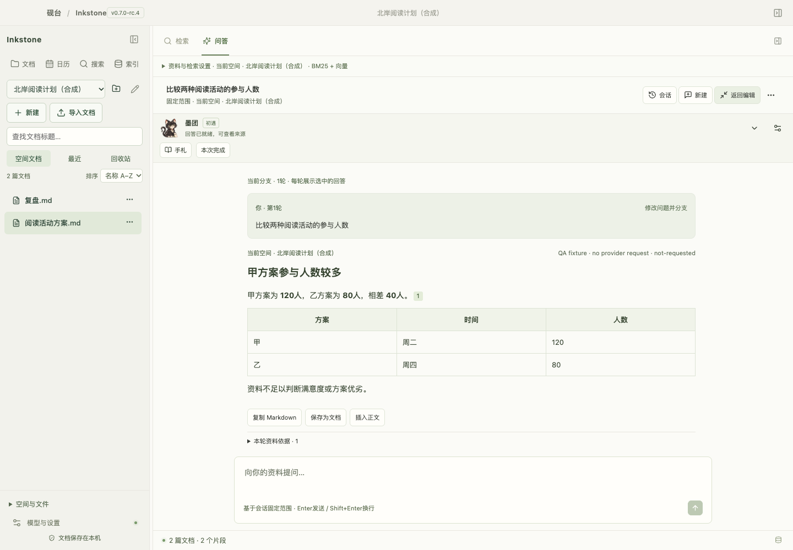

# Inkstone · 砚台

**Write locally. Ask your notes. Check the sources.**

A Markdown workspace and evidence-based knowledge assistant for **macOS 13+ on Apple Silicon**. Bring your own compatible model API. Keep an optional ink companion beside your work.

[中文](docs/README.zh-CN.md) · [Start from source](docs/QUICKSTART.md) · [Roadmap](docs/ROADMAP.md) · [Releases](https://github.com/raistlinsha-plus/inkstone/releases) · [Feedback](https://github.com/raistlinsha-plus/inkstone/issues)

**v0.7.0-rc.5 · local stability candidate.** The public source preview is v0.7.0-rc.4. The interface uses Chinese labels. See the [candidate delivery record](docs/DELIVERY-v0.7-rc5.md) for macOS acceptance and distribution status.



*Current production UI with isolated synthetic data and simulated model responses. This screenshot demonstrates the interface, not a live-model quality result. No private documents or credentials are shown.*

## What makes Inkstone useful?

- **Documents you can keep.** Copy-import local Markdown/text, organize document spaces, preserve originals, and compare source updates explicitly. History, backups and recovery stay local.
- **Answers you can inspect.** Continue scoped conversations, follow references back to source snapshots, branch questions and save a useful answer as a document. BM25, optional vectors and reranking work behind explicit evidence checks; missing facts can be refused.
- **Rich content inside Markdown.** Edit JSON trees, Mermaid, mindmaps, calendars and constrained ECharts blocks in the document body, then switch back to source.
- **A quieter companion.** Optionally enable Motuan, Yanzhou or Zhiwei. Confirm real work milestones to unlock fixed stories and stage artwork. Companions add no separate model call; current art is static release-candidate art.


## Watch the workflow


The walkthrough uses fictional data and fixture responses, with no live model request. It shows the UI workflow, not measured response speed or guaranteed answer accuracy. [Larger MP4 and publishing materials](docs/launch/v0.7/README.md).

## Try it from source

You need Apple's command-line developer tools, Node **24.14.0**, npm **11.9.0**, and Rust **1.99.1**. See `toolchain.json`.

```sh
npm ci --registry=https://registry.npmjs.org
npm run desktop
```

Start with the [fictional reading plan](examples/v0.7/阅读活动方案.md): compare 120 vs 80 participants, inspect the source, then ask about missing satisfaction data. [Quickstart](docs/QUICKSTART.md) explains importing, indexing, model setup and expected limits. Source installation downloads dependencies and compiles locally; first setup takes additional time.

Editing and keyword search do not require model credentials. To generate answers or use vectors, configure your own compatible API and model in settings. Reranking uses a separately configured Cohere-compatible endpoint.

Build an independent local app with `npm run bundle`. Use `/Applications/Inkstone.app` as the single daily installation and keep temporary build/test bundles separate. This is a locally ad-hoc signed build, not a notarized public installer. It runs without Node or a development server after building. [Installation/data boundaries](docs/LOCAL-INSTALLATION.md).

## Local data, explicit model requests

Documents, history, indexes, conversations and companion state stay on your Mac. Model operations transmit selected text, questions, candidate snippets or evidence to **the provider you configure**, which may charge usage fees. Multi-turn generation can include limited earlier user questions and enabled presentation preferences. Keys use macOS Keychain. Keyword-only search makes no model request. No weights, hosted account or document server are bundled. [Security policy](SECURITY.md).

## Candidate status

Local integration tests and synthetic-browser checks are recorded in the [current readiness assessment](docs/GITHUB-READINESS-v0.7.md). They do not establish native accessibility, cross-machine installation or general RAG accuracy. Five natural usage days, final artwork, native IME/VoiceOver, third-party binary notices and macOS distribution acceptance remain gates before a stable release. PDF/OCR, cloud collaboration, arbitrary document-set Q&A and a floating desktop pet are not shipped. [Known limits](docs/KNOWN-LIMITATIONS.md).

Want to help? Try a workflow, report a small fictional reproduction, or independently review a retrieval case. [Contributing](CONTRIBUTING.md) · [Architecture](docs/ARCHITECTURE-v0.7.md) · [Technology](docs/TECH-STACK-v0.7.md). If this direction is useful to you, a star helps others find it.

## License

Inkstone source is **Apache-2.0**. Dependencies retain their licenses, including some unmodified MPL-2.0 packages; see `LICENSE`, `NOTICE`, `THIRD_PARTY_NOTICES.md` and `licenses/`. Twenty acquired packages still lack standalone local notice text, so binary redistribution review is incomplete. Artwork provenance and candidate status are recorded under `src/companion/assets/`.
