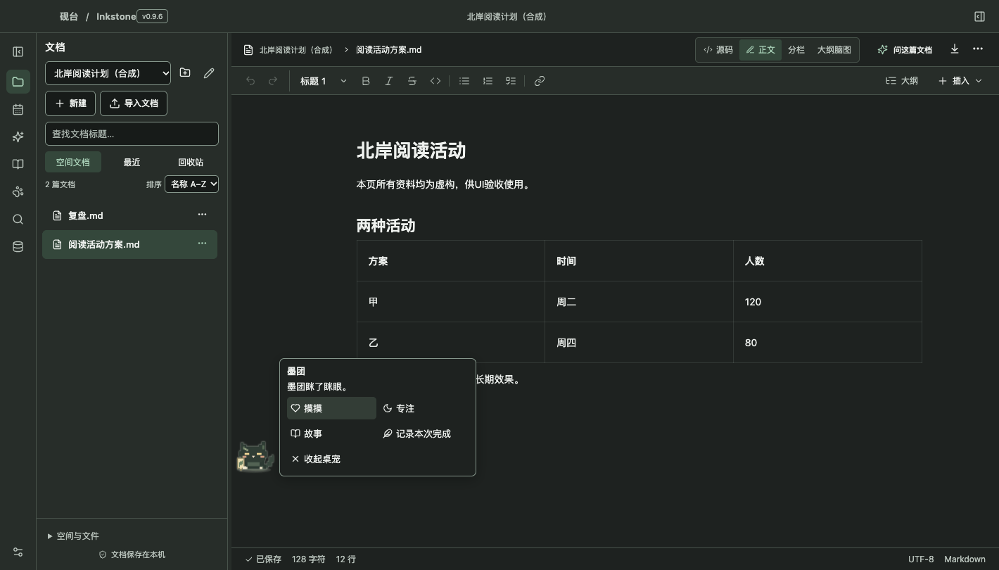

# Inkstone · 砚台

Inkstone is a local-first Markdown workspace for **macOS 13+ on Apple Silicon**. Bring in project notes from different folders, build a Wiki from the ones you select, and ask questions with citations you can open at the original passage. You can save an answer as Markdown and return to the line you were editing.

[Try the browser demo](https://raistlinsha-plus.github.io/inkstone/) · [中文介绍](docs/README.zh-CN.md) · [Get the RC.4 source prerelease](https://github.com/raistlinsha-plus/inkstone/releases/tag/v1.0.0-rc.4) · [Build from source](#try-it-from-source)



*The v0.9.6 editor with fictional project notes. The optional pixel-art companion sits in the page margin and can record a work milestone when you choose.*

**Trying RC.4?** Open a note and ask two things at once. Follow each citation back to the note to see which parts it answers. You can opt in to an extra quotation check by your chat provider, grant another tool read-only search in one space, or preview which Wiki versions a source withdrawal would remove. The candidate still misses supported answers. In a blind AI review, 15 of 40 test answers met all accuracy and citation criteria, the same score as RC.3. [RC.4 behavior and evaluation](docs/DELIVERY-v1.0.0-rc.4.md) · [CLI guide](docs/EXTERNAL-TOOLS.zh-CN.md)

## What you can do

- **Keep your own documents.** Copy-import Markdown, TXT, JSON or Mermaid files into a space. Edit the copies, compare later changes with the originals, and export your work. Use source and rich editing side by side for tables, JSON trees, diagrams, mindmaps, calendar entries and constrained ECharts charts.
- **Ask while writing.** Ask about one document, follow a citation to its source and return to your selection. For an unrelated translation or a new research question, use standalone chat. You can attach text files or pick documents from one space for that turn.
- **Review what your Wiki says.** Select the documents it may use. Inspect the proposed changes and their cited lines, including cases where documents disagree. If a summary lacks support, you can publish just the verified excerpts. Keyword search, optional vectors, verified Wiki references and optional reranking help locate evidence for an answer.
- **Work with a companion.** Pick Motuan, Yanzhou or Zhiwei. The three pixel-art characters dock on either edge of the editor, shrink to a bookmark in narrow layouts and respond when a document answer is ready. Confirming work milestones unlocks stories, keepsakes and illustrations. The companion works locally and supports reduced motion. [Poses in light and dark themes](docs/assets/v0.9.6/companions.png)

## Try it from source

The GitHub release provides a source archive and SHA-256 checksum. The desktop interface is in Chinese. To run it on your Mac, install Apple's command-line developer tools, Node **24.14.0**, npm **11.9.0** and Rust **1.99.1**. [Pinned toolchain](toolchain.json)

```sh
git clone --branch v1.0.0-rc.4 https://github.com/raistlinsha-plus/inkstone.git
cd inkstone
npm ci --registry=https://registry.npmjs.org
npm run desktop
```

1. **Without a model key**, open **从资料到第一条回答 → 用示例体验** in the document space. Search for **阅读活动** (reading events) and open the original paragraph. The browser demo also lets you try this workflow using fictional notes and simulated answers.
2. **With your own compatible chat API**, import the two sample notes. Ask how many events were planned and how many took place, open each citation, then ask whether the notes report participant satisfaction. [Sample notes and walkthrough](examples/v0.7.3/README.md)
3. **To keep using the app**, run `npm run bundle` to build an ad hoc signed app. It runs independently of Node and the development server. See the local installation guide before replacing an existing copy. [Local installation and data](docs/LOCAL-INSTALLATION.md)

## Local data and model requests

Editing, keyword search, companion stories and document backups work on your Mac. Documents, indexes, conversations and Wiki state are stored locally. When you ask a model to answer or organize a Wiki, the configured service receives the question or the relevant material for that task. Embeddings use your embedding endpoint and reranking uses a separately configured Cohere-compatible endpoint. These services can incur usage charges.

If you configure and authorize Brave Search, the model can decide when public information is useful. Brave receives a validated public query. You can disallow web search for a turn. Service keys are stored in macOS Keychain. [Security policy](SECURITY.md) · [Search and citation limits](docs/KNOWN-LIMITATIONS.md)

## Documentation and feedback

| Looking for | Start here |
| --- | --- |
| First use and daily tasks (Chinese) | [Quickstart](docs/QUICKSTART.md) · [User manual](docs/USER-MANUAL.zh-CN.md) · [Product and features](docs/PRODUCT.md) |
| System design and evaluation | [Architecture](docs/PUBLIC-ARCHITECTURE.md) · [Technology stack](docs/TECH-STACK.md) · [Paired document Q&A evaluation](evals/v1.0/rc4/README.md) |
| What changed | [RC.4 results and limitations](docs/DELIVERY-v1.0.0-rc.4.md) · [Changelog](CHANGELOG.md) · [Roadmap](docs/ROADMAP.md) |
| Trying or contributing | [Preview feedback](https://github.com/raistlinsha-plus/inkstone/discussions/11) · [Contributing](CONTRIBUTING.md) · [Known limitations](docs/KNOWN-LIMITATIONS.md) |

## License

Inkstone source is **Apache-2.0**. Dependencies retain their own licenses, including unmodified MPL-2.0 components. The repository tracks outstanding license texts and artwork provenance for binary distribution. [License](LICENSE) · [Notices](THIRD_PARTY_NOTICES.md) · [Artwork credits](src/companion/assets/README.md)
