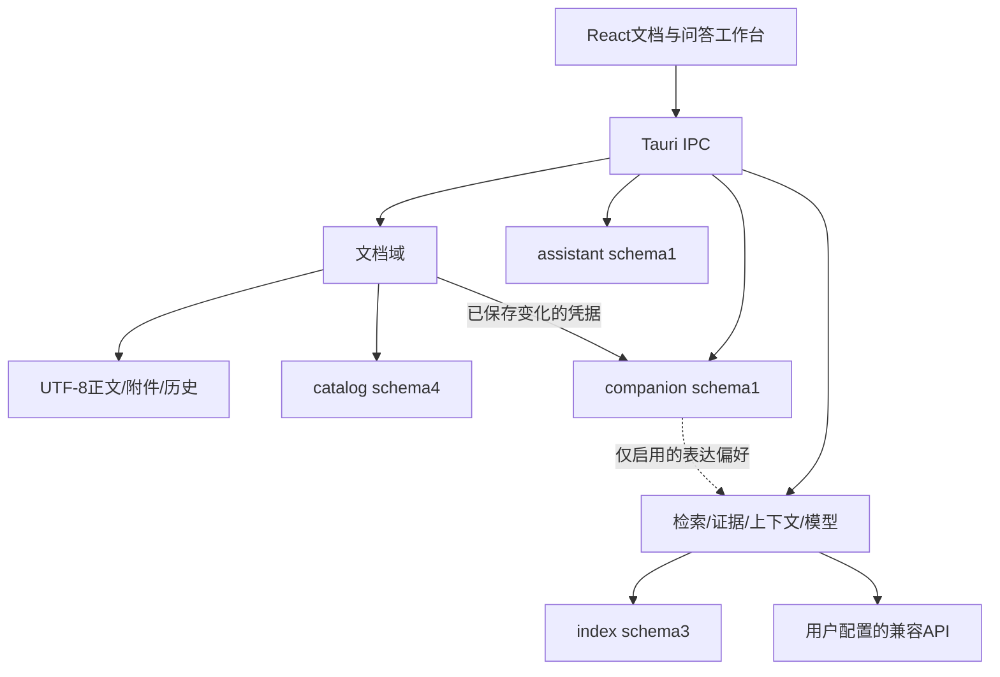

# Inkstone v0.7 当前4A架构

2026-11-07；版本 **0.7.0-rc.4 candidate**。本文以当前候选代码为准，替代阅读旧版本逐次增量时产生的现状歧义；历史交付记录继续保留。[技术栈](TECH-STACK-v0.7.md) · [候选交付及验收边界](DELIVERY-v0.7-rc4.md)。

4A在本文指业务架构、应用架构、数据架构和技术架构。Inkstone是面向个人Mac的本地桌面单体，没有必需的云端文档服务、账号系统或内置模型权重。

## 1. 业务架构

| 领域 | 当前能力与业务对象 | 边界 |
| --- | --- | --- |
| 收集与组织 | 文档空间、稳定文档ID、复制导入、来源关联、置顶、回收站、历史与备份 | 空间可汇集不同磁盘目录的副本；高级外部目录模式直接编辑原件 |
| 写作与表达 | 纯文本/Markdown，源码/正文/分栏，大纲；JSON、Mermaid、脑图、日程、受约束图表 | Markdown及专用围栏是内容源；没有任意富文档布局、PDF/DOCX/OCR |
| 发现与问答 | BM25、可选向量、RRF、可选重排、证据检查、引用、回答转存 | 相关度不能授予证据资格；模型回答仍需用户核对 |
| 持续会话 | 空间/单文档冻结范围、草稿、追问、问题分支、回答候选、历史、归档、导出 | 暂无任意文档集合选择；旧回答不成为本轮事实依据 |
| 陪伴与成长 | 墨团/砚舟/知微，三阶段、九章、经历确认、偏好、形象/CG相册 | 自愿启用；普通提问/保存不直接增长，经历和故事不进入RAG |

主要路径：复制导入或新建文档 → 编辑保存 → 本地索引 → 选定范围问答 → 核对本轮来源 → 显式保存/插入回答。来源更新由用户比较确认，冲突时阻止覆盖或保留两份。

陪伴路径：开启角色 → 阅读初遇 → 修改并成功保存文档 → 预览并确认经历 → 满足条件后主动阅读新章。工作保存与经历入账独立，经历失败不能回滚正文。每日最多两条，同文档同有效日去重；相识需3条经历/2个不同日，同行需8条/5个不同日、前章及实际复盘条件。

## 2. 应用架构

| 模块 | 职责与所有权 |
| --- | --- |
| `src/App.tsx`、`src/shell` | 桌面工作台编排、导航、文档/问答布局与展示；App仍承担较多跨域协调 |
| 文档会话、编辑器、`src/content`/`src/rich` | 正文状态、保存冲突与恢复；共享Markdown/结构块解析和呈现契约 |
| `src/platform`、解析Worker | IPC与可选布局偏好边界；较重内容解析离开主线程 |
| `src/assistant` | 会话头部、时间线、分支/候选、串行草稿与生成队列、流式缓冲；回答操作绑定自己的快照 |
| `src/companion` | 角色入口、故事/相册、经历/偏好和数据控制；不拥有可写文档副本 |
| Rust `library`、`documents`、`files` | 空间/文档身份、文件边界、安全保存、来源更新、历史、恢复与导入 |
| Rust `db`、`retrieval`、`evidence`、`providers` | 索引、召回/融合/重排、证据门控、上下文预算与用户API请求 |
| Rust `assistant`及commands | 会话持久化、修订校验、分支/候选身份、未完成生成恢复与追问来源核对 |
| Rust `companion`及commands | 保存凭据、确认事务、去重/日界、章节条件、偏好和清空/导出 |
| Rust `maintenance` | 写入准入与排空、备份一致快照、包校验及新目录恢复预演 |

问题在后端begin持久化后发出接收确认；前端才清空相同输入。正常导航/退出等待草稿刷写，失败阻止切换；生成期间新草稿排队到完成或退出前。历史使用后端过滤/分页；当前分支与全部候选分别导出。停止后的非空部分响应必须仍通过来源身份/hash核对，保存为stopped/cancelled候选，不参与先前完整回答的来源提取。

追问仅复用重新核对过的此前来源身份；当前所问属性单独约束证据，不把旧问题词项或旧AI断言补成事实。生成提示最多带此前最近6个用户问题、合计4000字符，属于语境而非证据。缺项/指代不明时保守澄清或拒答，当前词项策略仍有自然问法漏答风险。

## 3. 数据架构

| 数据 | 当前版本与事实来源 |
| --- | --- |
| 文档正文、图片、历史、恢复草稿 | 本机文件；正文是内容事实来源，导入后编辑受管理副本 |
| `library/catalog.sqlite3` | schema4；删除阶段日志、预览令牌、空间、文档ID、显示标题/路径、来源、历史、导入及恢复操作元数据 |
| 应用数据目录`workspaces/<工作区根路径hash>.sqlite3` | schema3；FTS5与向量等派生索引，可按保存内容重建 |
| `assistant.sqlite3` | 独立schema1；conversations、turns、candidates；冻结范围、草稿、父分支、请求ID、选中候选及回答/来源快照 |
| `companion.sqlite3` | 独立schema1；state、receipts、tokens、pending；角色设置/章节、去重账本、经历卡、偏好、待确认意图 |
| API凭据 | macOS Keychain；不写入项目文档和备份，不保存macOS登录口令 |

角色经历使用generation/revision防止重置后或旧上下文回写。15分钟预览凭据来自后端已保存变化；确认先持久保存意图，再单独奖励，重试保持幂等。卡片文字删除不撤销去重账本，进度不因删除文字反复获取。

完整备份采用 **format2**：排空已接受写入、冻结新准入，对两个辅助库生成一致SQLite快照，校验hash、结构与领域语义，再复核源内容和目录成员。兼容读取format1，缺少会话/角色库时明确提示；恢复到新目录预演，不直接覆盖当前资料库。备份可包含私人问题、引用和经历，已导出旧包不随应用内删除而消失。

## 4. 技术架构与运行边界

Tauri 2/Rust承载本机文件、数据库和网络；React 19/TypeScript运行于系统WebKit；Worker处理内容解析。代码模块是单体内的逻辑边界，不是微服务。

向量化发送所选文本片段，重排发送问题和候选摘要；问答发送当前问题、选定证据、有限此前用户问题及启用的表达偏好。关键词检索本身无需模型。外部服务由用户配置，远程要求HTTPS，本机回环可HTTP；没有新增独立陪伴模型调用。

文档/模型输出不授权文件或外部动作；渲染器、结构块与图表受格式约束。故事/经历不参与事实检索，表达偏好不能改变权限、资料或证据资格。合法引用或图表不等于语义已全面核验。

目标为macOS13+ Apple Silicon（arm64）；候选包采用ad hoc临时签名，未Developer ID、公证或跨机验收。本轮自动回归不覆盖真实WebKit交互、拼音候选、Keychain系统授权及VoiceOver；自然多日成长和最终sprite动作/像素美术签收仍待完成。当前是候选版本，最近公开源码预览仍为v0.6.6。

## rc.4 文档生命周期边界

共享排序选择器与每空间偏好独立于 opened。`library/lifecycle.rs` 管理专属副本清单、短期预览、prepared/committed 阶段日志、回退与续清；维护独占阻止备份或在途写入产生半态。副本删除时清理未确认经历凭据，历史问答/确认卡片文本保留但不成为新证据。完整协议见[正式版设计](design/v0.7-stable/ARCHITECTURE.md)。

## 本机部署边界

生产 bundle ID 为 `local.inkstone.desktop`，本机唯一日常程序入口为 `/Applications/Inkstone.app`。程序副本、当前源码与编译缓存、生产资料、隔离验收资料和恢复压缩包分别管理；多个旧程序原先共享同一资料目录，此次整理不重复合并文档。部署及清理规则见[本机管理说明](LOCAL-INSTALLATION.md)。
