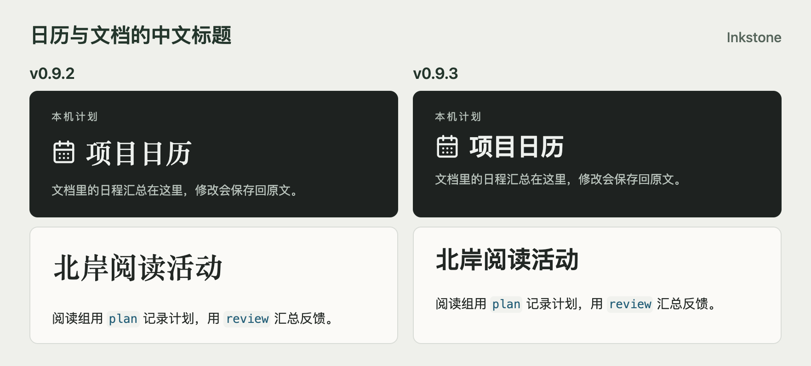

# Inkstone v0.9.3 · 工作区字体与文档问答

在日历里看到「项目日历」、在空间首页看到空间名、在正文里看到一级标题，现在都能认出同一套系统无衬线字体。标题仍按字号和字重区分层级，源码与行内代码用等宽字显示。浅色和深色外观使用同一套排版。

## 在文档旁边提问

1. 打开一篇文档，点「问这篇文档」。侧栏顶部显示本轮资料范围，可以直接核对文件名。「检索设置」里可以查看或调整检索方式。
2. 在底部输入问题。输入框从一行起步，随草稿增高，长草稿可在框内滚动。Enter 发送，Shift+Enter 换行。需要限制本轮网页搜索或调整回答选项时，使用输入框底部的控件。
3. 回答里的「本轮依据」可以打开来源预览。历史和新会话入口在顶栏，「更多会话操作」里可以展开问答或打开回答偏好。
4. 在宽窗口中，可拖动编辑区与侧栏之间的分隔线。用 Tab 移到分隔线后，也可用左右方向键调整宽度。

## 在窄窗口编辑

正文格式栏保持单行。标题、加粗、列表、链接使用同一底色和按钮尺寸。可见空间较少时，可在「更多文字格式」中继续使用收起的命令。「标题样式」支持方向键选择，Enter 应用，Esc 回到触发按钮。编辑正文时指针为文本光标，移动到块的拖动手柄时显示抓手。

空间首页按当前外观显示文档数、置顶数和文档列表。新建和导入放在空间标题旁，索引状态、导出和备份在资料操作行。深色模式下，「问这篇文档」、标题菜单、行内代码随当前主题着色。

## 本轮与后续版本

v0.9.3 汇集了 v0.9.2 之后的本机体验修订和这次字体更新。下一项有据问答工作将改进中文改述和复合问题的取证，并用冻结题集逐题评阅。检索质量的实测基线和新版界面分别记录。[问答评测](../evals/v0.9.1/README.md) · [中文路线图](ROADMAP.zh-CN.md)

GitHub 源码预览提供源码归档与 SHA-256 校验文件，可在 Apple Silicon Mac 上自行构建。[源码快速开始](QUICKSTART.md) · [发布记录](https://github.com/raistlinsha-plus/inkstone/releases)
