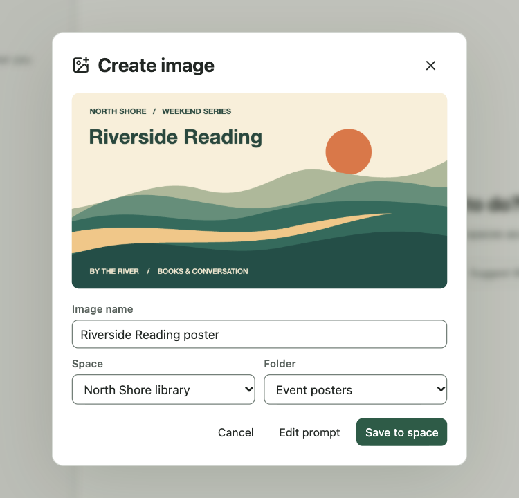

# Inkstone 1.4.0 · Work with images in a local project

Build 10225 runs on Apple Silicon Macs with macOS 13 or later. The stable release incorporates the rc.2 reliability work and the rc.3 cross-workflow regression work. The GitHub release includes source and a SHA-256 checksum for the source archive.

## Bring a picture into a conversation

- Add a library picture and a note to the same general chat turn. Choose existing OCR to ask about visible text, or reuse a saved description. Both text options remain available if the JPEG preview fails to load.
- To send pixels, review the JPEG preview, model and service address. The viewer and chat check the approved destination and preview. A changed model, destination or preview requires fresh confirmation.
- Generate an image with your own compatible provider, inspect it and choose a project folder. Retry a failed folder listing to save the same result. You can return to a pending preview when closing the dialog or quitting Inkstone. Dropping a Finder file while reviewing a preview keeps the dialog open. The provider must support a compatible images/generations endpoint and return inline image data.

## Keep your place in Tasks and Calendar

Switching spaces inside Tasks or Calendar keeps that page open. Archived spaces protect their source documents from writes. Return to the same space to continue a task or calendar draft during the session. Calendar remembers the date and filters you were viewing. Following a task to a specific date opens that date.

## Edit large maps and review Wiki changes

The standalone map canvas supports up to 500 topics. Existing topics remain editable at the limit. Open an oversized map in source view, reduce its topic count and return to the canvas. Wiki lets you save or discard pending scope changes before leaving. The clear confirmation explains the impact in English and Simplified Chinese.

## Verification and distribution

A synthetic HEIC photo went through macOS OCR. Two chat turns combined its OCR or saved description with the same note. All four citations returned to the corresponding image or note lines in the desktop frontend. The tests used a local model fixture. Native WKWebView checks also covered Chinese composition mid-document and bold formatting across views. Image generation was tested with a local provider fixture. Real generation depends on the model enabled on your provider account. The previous candidate used a live vision model to read separate facts from a sample image and a note. The stable offline retrieval replay ran 40 target turns and 10 setup turns. The final context covered 21 of 53 evidence points, including 2 of 13 follow-up points. All 40 target turns stayed within the selected scope. A signed and notarized public Mac installer is pending separate distribution testing.

[English user guide](USER-MANUAL.en.md) · [Build from source](QUICKSTART.en.md) · [中文交付说明](DELIVERY-v1.4.0.md)
