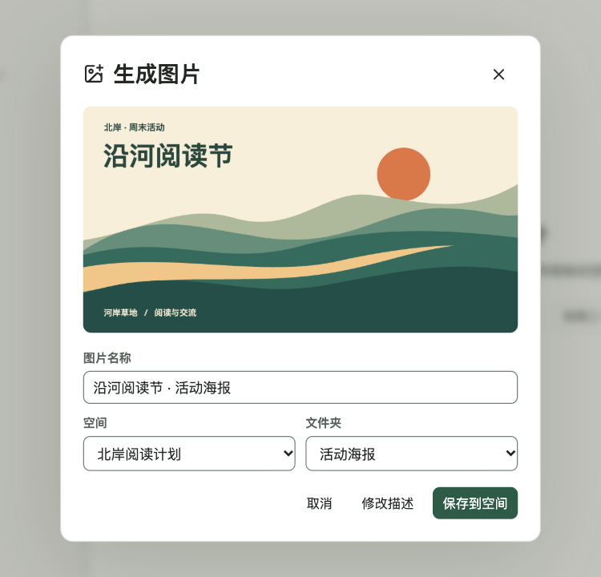

# Inkstone 1.4.0 · 从图片问答到项目归档

构建 10225，适用于 Apple Silicon Mac，最低 macOS 13。这个稳定版合并了 rc.2 的资料与编辑修复，以及 rc.3 的跨流程回归工作。GitHub 提供源码和源码归档的 SHA-256 校验值。

## 把图片用进工作流

- 在通用问答里添加一张空间图片和一份笔记。问图上的字时选择已有 OCR，也可以选已经保存的描述。即使 JPEG 预览读取失败，已有文字仍可用。
- 让模型看画面时，先核对缩小后的 JPEG、模型和服务地址。图片详情和对话使用相同的发送检查。提供商、模型或预览变化时，需重新确认。
- 用自己的生图服务生成后，可以查看预览，给图片命名并选定目标文件夹。如果文件夹加载失败，重新读取目录即可继续保存同一张图。关闭预览或退出应用前可以返回保留待保存结果。在预览中从 Finder 拖入文件会保留当前窗口。生成服务需支持兼容的 images/generations 接口并返回内联图片数据。

## 在任务、日历与文档之间切换

在任务或日历中更换空间，仍停留在当前页面。活动空间可以接收新任务和排期，已归档空间的原文受到写入保护。临时离开任务或日程表单再回来，可继续填写当前空间的草稿。返回日历时会恢复之前查看的日期和筛选，主动从任务跳往指定日期时则打开该日期。

## 较大的脑图与 Wiki 审阅

独立脑图的画布编辑上限是 500 个主题。到达上限后仍可编辑现有节点。超限的既有文件可以进入源码，缩减节点后恢复画布。Wiki 资料范围有改动时，离开前可以先保存或放弃。清除操作会先说明涉及的内容，支持简体中文和英语。

## 验收范围

使用合成 HEIC 照片验证了 macOS 本机 OCR。分别用 OCR、已保存描述与同一篇笔记提问，两轮的四条引用都返回了对应图片或笔记的原行。模型应答来自本机模拟服务。原生 WKWebView 另验证了长文中段的中文组词、上屏和加粗往返。生图以本地模拟供应商验收，真实服务取决于用户配置的模型。上一候选曾用真实视觉模型从测试图和配套笔记分别读取指定内容。本版离线重放了 40 个目标轮次和 10 个铺垫轮次。最终上下文覆盖 21/53 个必要证据要点，追问覆盖 2/13，40 个目标轮次均未使用范围之外的资料。公开签名、公证的 macOS 安装包仍待独立分发验收。

[中文操作手册](USER-MANUAL.zh-CN.md) · [从源码运行](QUICKSTART.md) · [English release notes](DELIVERY-v1.4.0.en.md)
