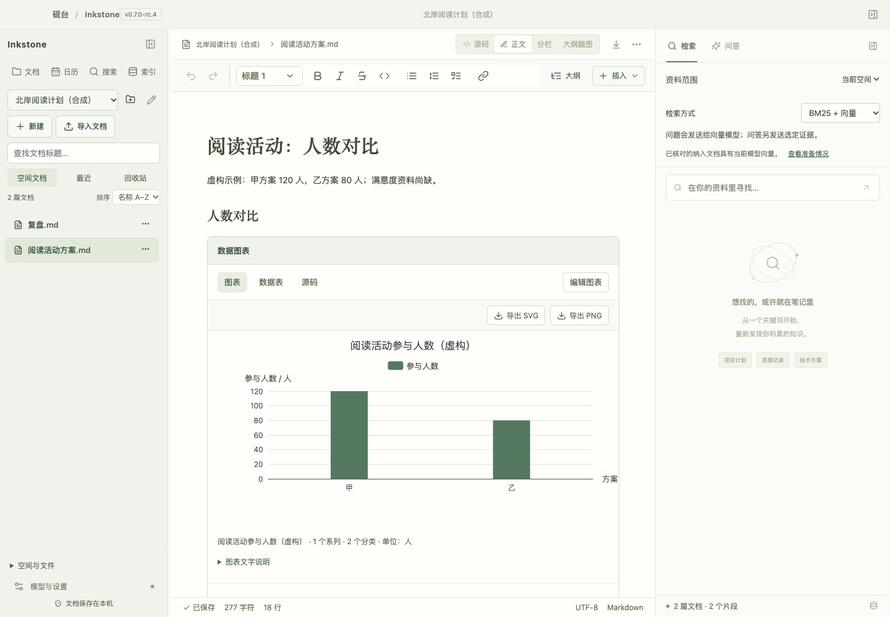
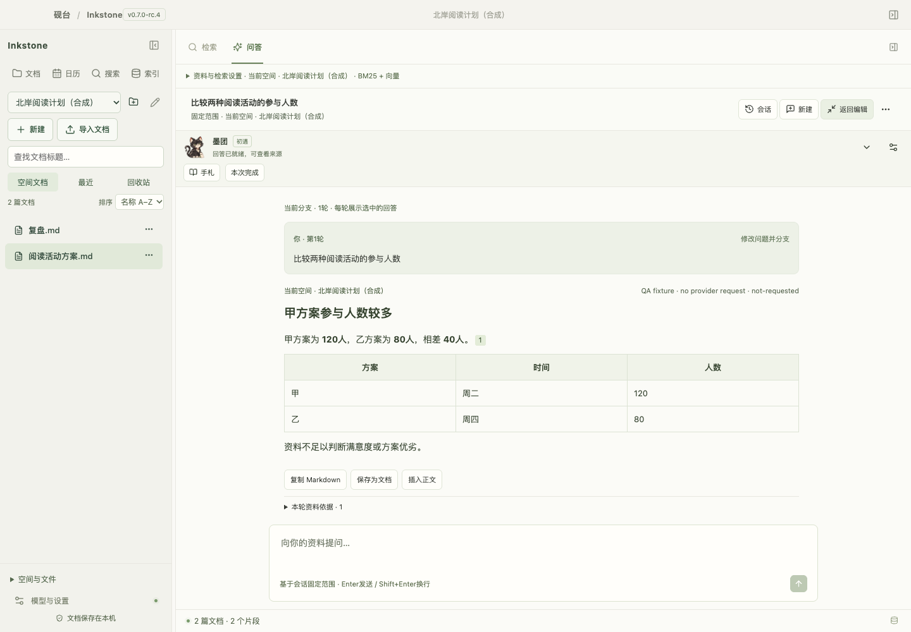
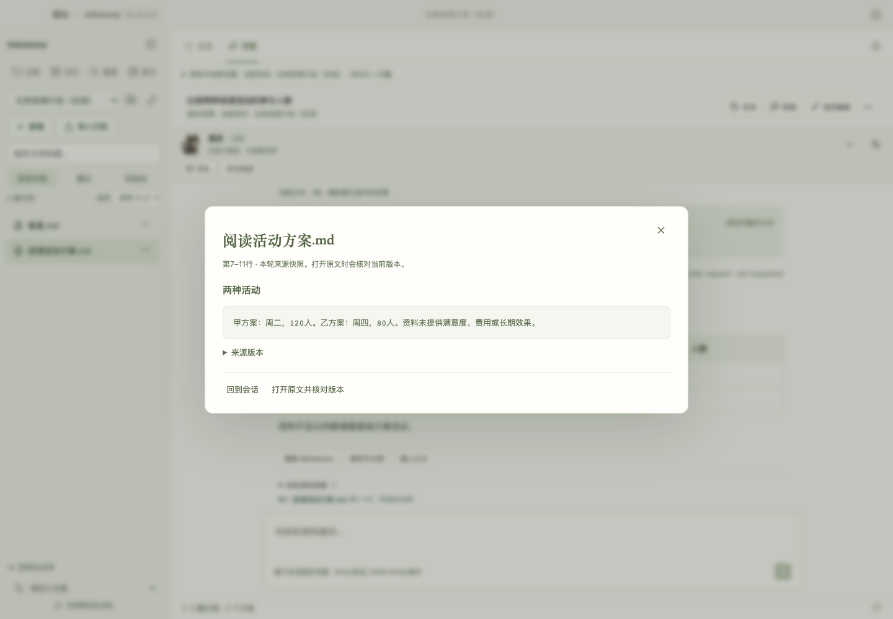
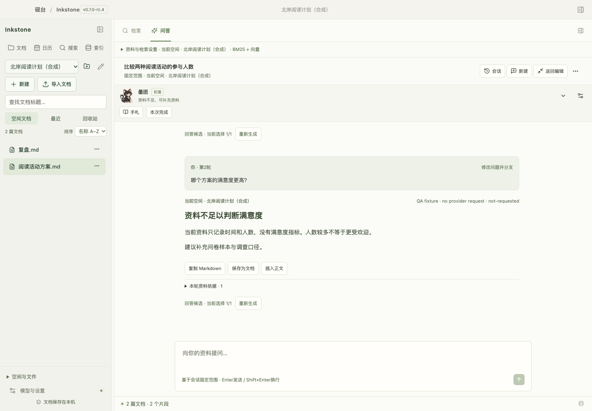
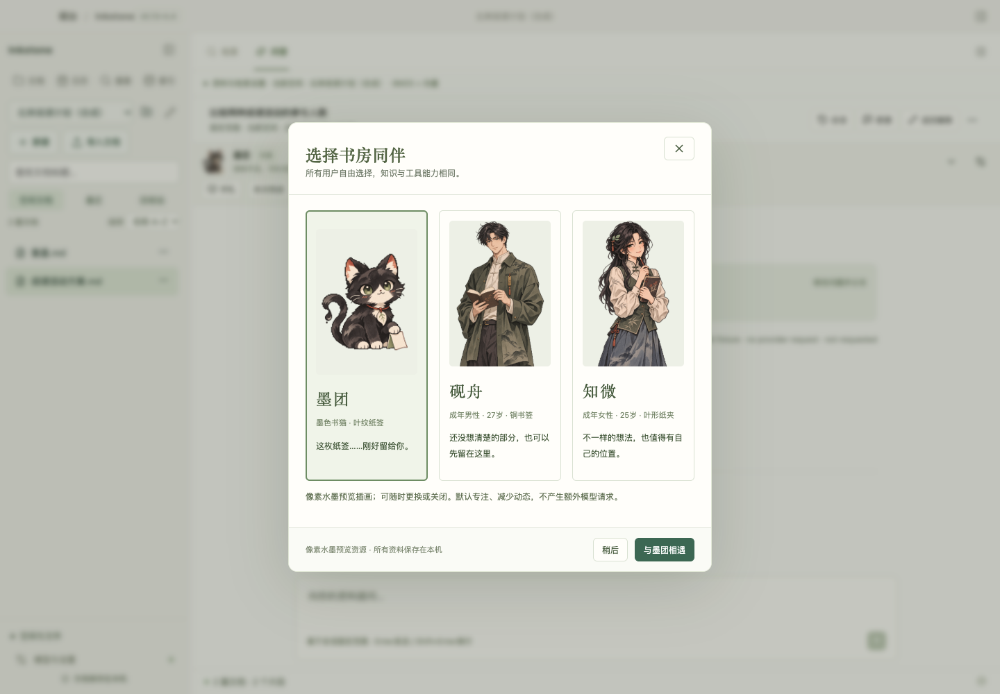

# v0.7 GitHub 更新条件与整体审查

2026-11-07；审查对象为 `v0.7.0-rc.4` 候选代码及本轮准备的传播材料。结论：**具备提交增量 PR、在目标提交托管检查通过后发布源码预览的基础；不具备宣称稳定 v0.7.0 或公开正式安装包的条件。** 本轮没有 push、创建远程 PR/标签/Release、修改仓库设置或发送推广帖子。

以下远端状态是发布准备时点的审查快照，发布后的制品与检查状态以 [Releases](https://github.com/raistlinsha-plus/inkstone/releases) 和 [Actions](https://github.com/raistlinsha-plus/inkstone/actions) 为准。

## 远程与本地的实际差距

只读查询 [现有仓库](https://github.com/raistlinsha-plus/inkstone)确认：公开 main 为 `8728003`，最新发布是 [v0.6.6 Source Preview](https://github.com/raistlinsha-plus/inkstone/releases/tag/v0.6.6)，属于 pre-release；本轮开始时本地 `c1c4626` 在其后有九个提交。已有受保护的 main、Issues 和六个相关 Topics；Homepage 为空、Discussions 关闭。查询时 Stars/forks 均为 0，源码包和校验和资产各有两次下载；下载次数不能当作独立用户数。没有读取私有 Traffic 或把不存在的数据填成零。

同一远程提交曾有一次成功检查，但最近两次失败。[最近失败任务](https://github.com/raistlinsha-plus/inkstone/actions/runs/41492657393)停在 Rust `single_flight_timeout_cancellation_and_late_success_do_not_stack_os_reads`：固定 sleep 后后台线程尚未发布结果，随后缓存断言收到 PENDING。不能用此前的成功状态宣称当前 CI 已绿。

本轮把测试中的模拟原生读取改为由通道显式释放，等待 watch 完成信号后再核对晚到结果缓存；保留真实超时、单次调用和全局槽位断言，没有跳过用例、重试掩盖失败或放宽生产 Keychain 等待规则。相关四项本地回归通过，单项并发用例另在三路进程中共复跑 12 次通过。**这项修正的远程 CI 尚未运行**，必须在 PR 中核对准确提交。

## 分级结论

| 级别 | 问题及影响 | 本轮处理 / 后续门槛 |
| --- | --- | --- |
| P1 · 预发布前 | 当前公开托管检查为红；访问者无法判断本候选的可复现性 | 已修正测试时序，本地复核；PR 目标提交必须重新跑绿再发源码预发布 |
| P1 · 安装包前 | 20 项已获取依赖缺独立本地许可文本，仍有依赖公告；无 Developer ID、公证与跨机验收 | 保留来源/声明和命中详情，本轮只准备源码；不附本机 `.app`/资料备份作安装资产 |
| P1 · 稳定版前 | 自然多日成长、素材终稿、实际 Mac IME/VoiceOver 等未签收 | 继续候选标识，不把自动测试或合成浏览器当作这些检查 |
| P1 · 试用转化 | 需安装工具链并首次编译；界面仅中文，普通用户试用门槛高 | 新增中英文清晰入口及虚构样例；先面向技术用户，安装包具备条件后扩大推广 |
| P2 · 产品清晰度 | 首问、候选、范围、模型诊断及同伴入口仍在一屏中并列，信息量偏大（步骤 2/4） | 后续优先降低首次配置/索引认知负担，细节渐进展开；不把此次宣传整理当作 UI 已重新设计 |
| P2 · 素材一致性 | 人型与墨团卡片的文字起点不完全齐行，且人型插画仍明显不同于严格像素网格（步骤 5） | 保持“静态候选插画”口径，终稿统一画幅、文字基线及小尺寸呈现后再宣传完成版像素风 |
| P2 · 维护成本 | App 约 3,882 行、Rust lib 约 2,498 行、library 约 1,662 行，依然偏大 | 新增域继续独立模块；下一轮按领域抽离，避免与新功能同时扩大主编排入口 |

目前没有从本轮检查中确认新的生产数据丢失缺陷；这不等同于所有磁盘故障或任意资料均已验证。单篇彻底删除的临时目录/故障回归继续通过，日常生产文档没有用于破坏性测试。

## 新鲜界面证据与五步体验检查

本轮重新运行生产 React 前端，使用隔离合成 IPC、虚构阅读活动、模拟回答和真实候选角色资源。不会读取生产库、浏览器登录态、钥匙串或真实模型。以下均为当前采集，不借用旧截图作为本轮体验结论。

1. **文档与内嵌图表：通过合成界面检查。** 工具栏、新建/导入、文档空间及图表清楚可达；图表单位和虚构数据可见。首次导入/建库仍需要快速开始辅助，图示不能证明原生输入法。

   

2. **首问与回答：通过合成界面检查。** 问题、120/80/40、表格、候选和来源入口可见；扩展问答提供较完整阅读区。顶部固定范围、同伴、模型/检索与候选信息仍占据较多空间，是下一步密度打磨重点。

   

3. **来源快照：通过合成界面检查。** 标出文件和行范围、快照属性及“打开原文并核对版本”，不会把快照伪装成当前原文。模态背景隔离可见；真实 VoiceOver、键盘读序和所有焦点路径尚不能从截图认证。

   

4. **缺失属性追问：通过合成界面检查。** 回答明确缺少满意度，区分人数与效果；首问未丢失。此处回答由夹具提供，只证明呈现与上下文操作，不当作真实模型的语义正确率。已显式回到最新回答后再采集。

   

5. **同伴选择：通过合成界面检查。** 三角色可选、稍后入口可见，说明可关闭且没有额外模型请求。当前人型和猫型画幅、文字基线及像素风一致性仍需打磨，不宣称动画或终稿验收。

   

初次来源采集仍处于异步回答切换，定位器点击被收起状态挡住；已改为等待完成候选。另一张“追问”截图仍停留首问阅读位置，视觉复核后拒绝，显式跳到新回答重新采集。失败截图/日志保留在私有 artifacts，不进入发布素材。GIF/MP4 是这五张已复核截图组成的分步演示，不是实时录屏、模型耗时或真人使用研究。

## 工程、隐私、依赖检查

本轮默认全量检查覆盖前端 53 文件 / 282 项、Rust 178 通过 / 六项显式远程忽略，以及工具链、13 项工具测试、类型、Worker、生产前端构建、44 项原型检查和公开文档链接。本轮另有稳定列表/删除七组浏览器断言，多轮会话七组断言及六种宽度/布局组合；浏览器错误、外部请求和真实模型请求均为零。它们不是实际 macOS 可见交互验收。

扫描使用官方 Gitleaks 8.30.1，下载按官方发布 digest 核对。既有 Git 历史三项 generic-api-key 命中全部是 `public-snapshot.json` 的 SHA-256，经逐提交读取对应文件重新计算吻合；原始脱敏报告与逐项复核分开保留，没有全局忽略真实凭据规则。当前受跟踪文本的个人绝对 home 路径检查为零。候选截图全部人工查看，不含私人正文。最终工作树共扫描 1,544 个受跟踪文件，两项命中均为已逐项核实的原始快照 hash，未确认真实凭据；源码包清单另记录在本轮私有回执；扫描通过不证明不存在所有秘密。

官方 npm registry 全图审计仍为 **5 low / 0 moderate / 0 high / 0 critical**，来自 KaTeX 条件公告沿 Milkdown/Mermaid 数学链传播，不能算五个独立漏洞，也未把全部路径宣称不可达。没有为压低数字强行跨版本覆盖依赖。

OSV 对 Cargo.lock 的 **514 个 registry 包**查询发现五个包有命中：fxhash/proc-macro-error 为维护状态；glib 的两个公告标识属于同一问题；zstd 与 zstd-safe 有多个流、上下文和 unsafe 前提相关公告。macOS 链中的 zstd-safe 来自 jieba 固定字典的 include-flate 链，不是文档接收任意压缩流，但尚未完成所有公告的可达性证明，不能标为全部无风险。全锁图含其他平台和开发依赖，不能直接等同本机可利用漏洞。详见 [OSV](https://osv.dev/) 与 [RustSec](https://rustsec.org/advisories/)，原始查询及公告详情保存在私有回执。

许可清单包含 **792 项已获取依赖**，独立本地许可文本缺口仍为 20；源码、上游链接及未修改包的许可范围保留。角色素材的生成来源、hash、尺寸和未完成签收状态都有说明。源码预览与含第三方二进制的安装发行分开判断，不作“全部 MIT/Apache”宣传。

检查器原先只覆盖旧公开文档列表。本轮扩展到当前产品/技术/审查/快速开始及传播材料，并修正了 Known limitations 的 rc.1、贡献说明中“角色仅原型”、以及制品 manifest 中 catalogSchema3 的过时口径。catalog4 / index3 保持区分。原始 v0.6.6 快照清单仍保留历史含义，不拿它限制正常贡献者修改。

## 更新 GitHub 的建议

进入增量 PR，准确目标提交 CI 绿后创建 `v0.7.0-rc.4` **source pre-release**，只附源码及校验和；不重建仓库、不把全部私有历史、资料或旧应用备份带入。此时主要曝光面向愿意构建应用的开发者。稳定安装发行和普通用户大规模推广继续等待原生、许可及分发门槛。

本轮已准备中英文首页、Quickstart、样例、路线图、Release/PR 正文、About/Topics、社交卡片、GIF/MP4、社区成稿与两周验证计划，入口为 [发布传播包](launch/v0.7/README.md)。没有承诺 Stars 数量，也没有发送外部帖子。
