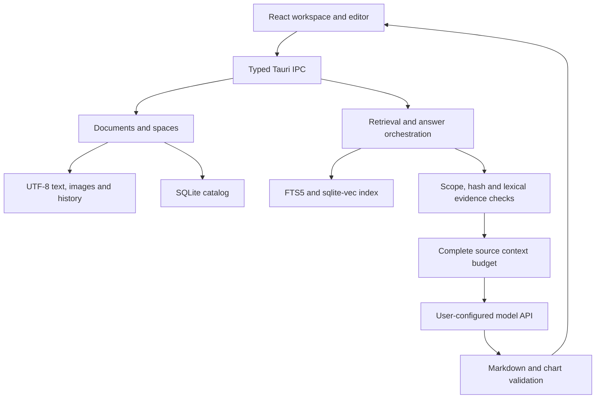

# Architecture and technology

Local candidate v0.7.0-rc.1; public source preview v0.6.6. Inkstone is a local desktop application; it has no required hosted document server, account service or bundled model weights. Candidate acceptance and remaining gates are recorded in [the delivery](DELIVERY-v0.7.md).

| Layer | Components and responsibility |
| --- | --- |
| Desktop shell | Tauri 2, system macOS WebKit, native file dialogs and Keychain boundary |
| Frontend | React 19 / TypeScript; app composition and typed IPC, document session, source/visual editor and worker-based parsing |
| Editing and presentation | CodeMirror 6, Milkdown 7; shared Markdown content contracts; JSON trees, Mermaid, Markmap, FullCalendar and constrained ECharts |
| Local backend | Rust: safe file writes, stable document/space identity, source updates, history, backups, indexing and remote provider calls |
| Storage | UTF-8 document files/images/history plus SQLite catalog/index and independent assistant/companion stores; FTS5, jieba tokenization and sqlite-vec |
| Models | User-configured OpenAI-compatible embedding/chat and Cohere-compatible reranking over HTTPS; loopback HTTP allowed |

A **space** is the main product unit. It can hold managed copies imported from several folders. A directory is a source or advanced direct-edit mode. The retrieval index is rebuildable derived data, not a second document truth.

Retrieval combines BM25 and vectors using RRF, then optionally reranks candidates. Relevance cannot grant evidence eligibility. Explicit comparisons can scope each source to its own document name while still requiring the common requested attributes, numeric constraints and the original two-thirds coverage threshold. Heading-only snippets are excluded. Before generation, source identity, scope and current file hashes are checked again. This remains conservative lexical support, not a semantic entailment guarantee.

`src/shell` owns display components; `src/platform` owns IPC and optional layout preferences. `src-tauri/src/evidence.rs` owns lexical evidence decisions; `retrieval.rs` owns shared query/ranking/context behavior. Documents remain governed by existing session, conflict, save and recovery rules. v0.6.6 adds no catalog/index schema migration (schema 3 remains).

Renderer frames and chart formats are constrained rather than arbitrary executable document code. Untrusted text and model output never authorize filesystem or external actions. See [security](../SECURITY.md) and [limits](KNOWN-LIMITATIONS.md).

Default verification runs local synthetic tests, types, worker checks, builds and document checks. `desktop-e2e` is a separate test identity with system credentials disabled and only loopback model stubs permitted; production builds exclude that feature. Real service evaluations are opt-in, bounded and recorded separately. `toolchain.json` and lockfiles define verified versions.

`src/assistant` owns conversation UI and streaming buffers; Rust `assistant` stores frozen space/document scope, drafts, branches, candidate answers and source snapshots in `assistant.sqlite3` (schema 1). Follow-ups reuse revalidated source identities, while the current question independently constrains requested attributes. At most six previous user questions, bounded to 4,000 characters, can enter the generation prompt; old model claims do not become evidence.

`src/companion` and Rust `companion` use `companion.sqlite3` (schema 1) for opt-in settings, story progress, confirmed experiences and presentation preferences. Only a valid changed-document save can create a short-lived preview token. Explicit user confirmation persists intent before awarding deduplicated growth; retries are idempotent. Stories and experiences never become retrieval evidence, and preferences cannot change factual eligibility. Candidate art is static; final sprite animation and multi-day natural acceptance remain pending.

Backup format 2 includes consistent snapshots of both stores under the maintenance write barrier, validates semantic contents and rechecks the source before publication. Format 1 remains readable and explicitly reports missing new stores. Catalog/index remain schema 3; restore still previews into a new directory. The standalone `prototypes/v0.7` demo remains a synthetic design reference.
