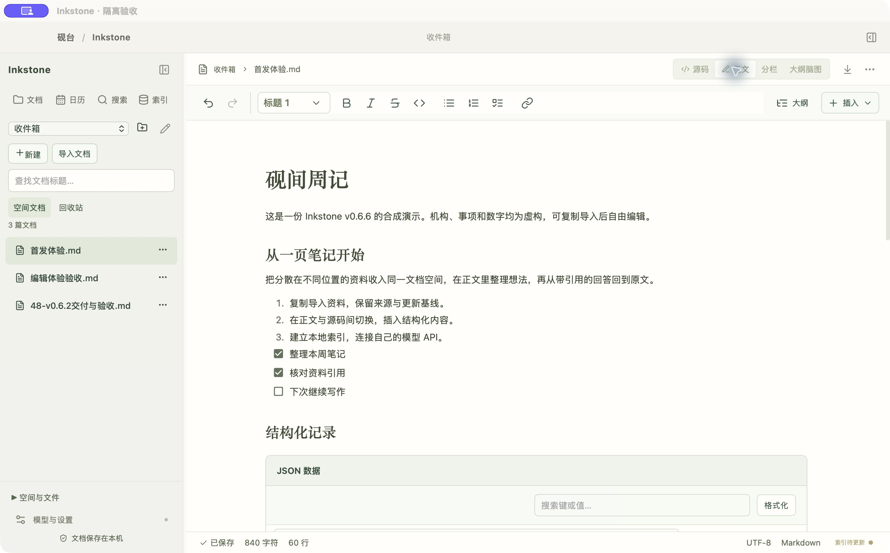
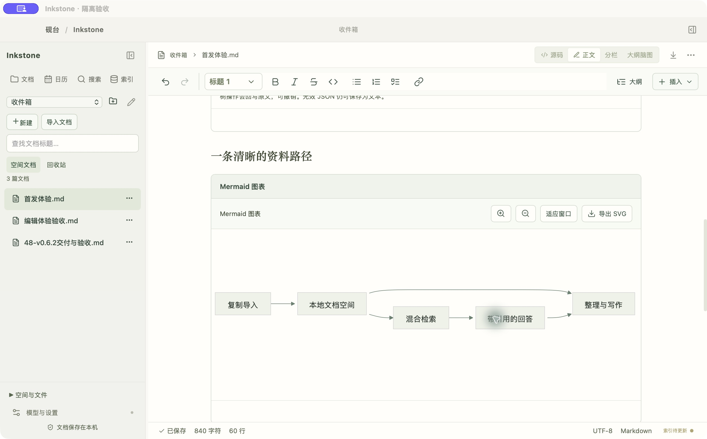
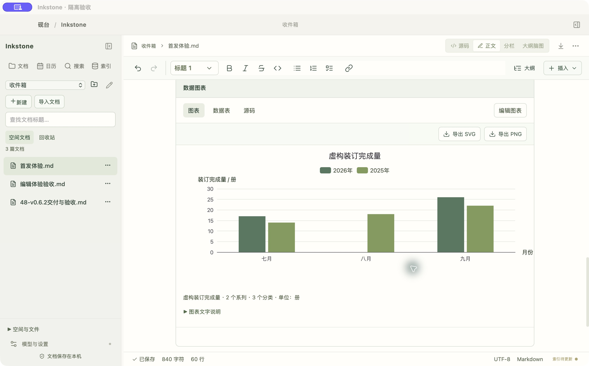

# Inkstone · 砚台

A local Markdown workspace and evidence-based knowledge assistant for **macOS 13+ on Apple Silicon**. Bring your own compatible model API. Version **0.6.6** is the first public **source preview**.

[中文说明](../docs/README.zh-CN.md) · [Architecture](../docs/PUBLIC-ARCHITECTURE.md) · [Release notes](../docs/PUBLIC-RELEASE-v0.6.6.md) · [Known limits](../docs/KNOWN-LIMITATIONS.md)



Screenshots use the isolated acceptance build and fictional content. They do not show private documents or a live model session. The interface currently uses Chinese labels.

## Write, organize and ask

- **Document spaces:** collect copies from different local folders, compare source updates, preserve document identity, history and backups.
- **Markdown editing:** switch between source and visual editing; JSON trees, Mermaid, mindmaps, calendars and constrained ECharts charts appear inside documents.
- **Local retrieval:** BM25, hybrid vector retrieval and optional reranking, with explicit fallback status, current-source checks and citations.
- **Rich answers:** Markdown and validated chart blocks, source navigation, and answer-to-document workflows.

v0.6.6 keeps startup loading until workspace/session restoration finishes, adds retry and pane visibility preferences, and improves explicitly named document comparisons without letting relevance scores grant evidence. Heading-only snippets cannot serve as answer evidence.

## Run from source

Install Apple's command-line developer tools, Node **24.14.0**, npm **11.9.0** and Rust **1.99.1**. Verified toolchain versions are in `toolchain.json`.

```sh
npm ci --registry=https://registry.npmjs.org
npm run verify
npm run desktop
```

Build a standalone local app:

```sh
npm run bundle
```

Output: `src-tauri/target/release/bundle/macos/Inkstone.app`. This uses a local ad-hoc signature. Developer ID signing, notarization, cross-machine installation and Intel/Windows/Linux acceptance are incomplete; this release provides source rather than an unverified installer. The bundled app does not need Node or a development server to run.

To try the editor, create a document space and copy-import [the synthetic sample](../examples/v0.6.6/首发体验.md). Existing files remain unchanged. Advanced external-directory mode edits originals directly and is separate from managed spaces.

## Connect your API

Configure OpenAI-compatible embedding/chat endpoints and models in settings; reranking uses a separately configured Cohere-compatible endpoint. Remote endpoints require HTTPS, while loopback services can use HTTP. Keys use macOS Keychain. No model weights, hosted account or document server are bundled.

Documents, catalog, history and indexes stay local. Model operations transmit selected chunks, questions/candidate snippets or evidence to the service you configure. Keyword-only retrieval makes no model request. [Security and data boundaries](../SECURITY.md).

Default tests use synthetic data and do not access production keys or paid models. The explicit [quality evaluation](../evals/v0.6.6/README.md) reports actual models, calls, failures, review and timing. Its small same-author corpus is not a general accuracy guarantee; abstract paraphrases can still be conservatively refused.

## Structured content





Graph/chart formats follow the application's data contracts. Chart presence, valid source IDs and numeric checks do not prove every generated fact. Confirm answers against the original sources.

## Roadmap and contributing

The next production milestone is v0.7: a restrained companion experience with shared work history, stories and character artwork. The separate `prototypes/v0.7` demo uses fictional browser-local state and placeholder compositions; the production app does not yet implement companions, growth, CGs or stories.

[Contributing](../CONTRIBUTING.md) · [Security](../SECURITY.md) · [Limitations](../docs/KNOWN-LIMITATIONS.md) · [Evaluation results](../evals/v0.6.6/RESULTS.md)

Use synthetic reproductions in issues. Never upload keys, passwords, your application data directory or an unredacted backup.

## License

Inkstone source is **Apache-2.0**. Third-party packages retain their licenses; see `LICENSE`, `NOTICE`, `THIRD_PARTY_NOTICES.md` and `licenses/`. Some unmodified transitive dependencies use MPL-2.0. Exact upstream versions and supplemental license provenance are recorded; standalone local text remains missing for 20 acquired packages, so binary redistribution review is incomplete. Source dependencies are fetched from their registries, not bundled as dependency executables in this preview.
