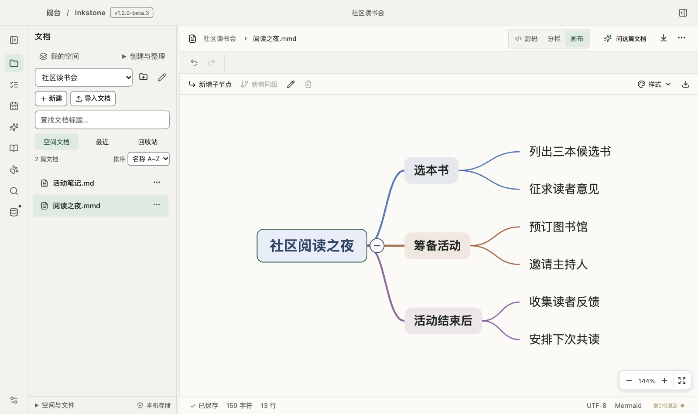

# 砚台 · Inkstone

**简体中文** · [English](../README.md)

砚台是一款面向 Apple Silicon Mac 的本地 Markdown 工作台。把笔记、iPhone 照片和脑图收进项目文件夹，用自己的模型向资料提问，点开引用核对原文，再把聊定的下一步变成任务，排进日历。

[**获取 v1.2.0-beta.3 源码**](https://github.com/raistlinsha-plus/inkstone/releases/tag/v1.2.0-beta.3) · [**在浏览器里体验**](https://raistlinsha-plus.github.io/inkstone/?lang=zh-CN) · [桌面版快速开始](QUICKSTART.md)



**在 Mac 上动手改这张图。** 导入示例脑图，双击一个节点改名，再把分支拖到画布空白处。它的子节点会一起移动。保存后再打开，就能从刚才排好的位置继续。[示例脑图](assets/v1.2.0-beta.3/zh-CN/reading-night.mmd) · [画布操作手册](USER-MANUAL.zh-CN.md#在画布上编辑独立脑图)

**在浏览器里试一次问答。** 两场阅读活动，哪场来的人更多？点开引用核对人数，再把后续安排排进日历。网页演示使用虚构笔记和预设回答，打开就能体验。[进入演示](https://raistlinsha-plus.github.io/inkstone/?lang=zh-CN) · [在 Mac 上试用同一份笔记](../examples/quick-tour/README.zh-CN.md)

## 从笔记到行动

| 你想做什么 | 在砚台里怎么做 |
| --- | --- |
| 收集资料，写一篇笔记 | 将不同目录的 Markdown、TXT、JSON 或 Mermaid 文件复制导入一个空间。可以用正文编辑，也可以分栏对照源码。表格、脑图、流程图和数据图表都能放在正文里。 |
| 收集照片，用文字找图 | 导入 HEIC/HEIF、JPEG 或 PNG，在空间中按名称翻看。macOS 在本机识别图中文字。需要理解画面时，可主动发送预览给视觉模型，把描述保存下来供检索和问答使用。 |
| 核对一个说法 | 在编辑器点「问这篇文档」，从回答引用跳到原段落，查看本轮实际使用的资料。需要换个话题时，进入「AI 问答」并为本轮单独添加文件。 |
| 跟进对话里的行动项 | 从对话选取原话，核对任务标题并选定目标笔记。在「任务」设截止日、安排执行时段，在「日历」拖动时段即可改期，点击来源可回到 Markdown 原行。 |
| 长期整理一个主题 | 选择允许 Wiki 使用的笔记，逐条核对拟修改的内容和引文。可以发布主题，也可以只发布已核验的摘录。笔记变化后可重新整理。 |
| 在页边留个同伴 | 选择像素角色陪读，确认一次完成的工作后可逐步解锁故事和插画。需要安静时可切到专注模式。 |

[查看任务清单](assets/v1.2.0-beta.1/zh-CN/tasks.png) · [查看日历](assets/v1.2.0-beta.1/zh-CN/calendar.png) · [产品与功能总览](PRODUCT.md)

## 从源码开始

这个预发布版提供源码。在运行 macOS 13 或以上版本的 Apple Silicon Mac 上准备 Apple 命令行开发工具、Node **24.14.0**、npm **11.9.0** 和 Rust **1.99.1**，然后运行下面的命令。[工具版本](../toolchain.json)

```sh
git clone --branch v1.2.0-beta.3 https://github.com/raistlinsha-plus/inkstone.git
cd inkstone
npm ci --registry=https://registry.npmjs.org
npm run desktop
```

1. 打开「我的文档」，在空间首页选择「从资料到第一条回答 → 用示例体验」。即使还没配置模型，也可以用关键词搜索笔记并打开原段落。
2. 使用 AI 时，在「模型与设置」添加兼容的问答服务。导入一份活动计划和一份复盘，提问“实际与计划差在哪里？”，点开引用核对。界面可切换简体中文或英文，回答语言可另行设置。
3. 运行 `npm run bundle` 可在本机构建独立应用，构建采用临时签名。已有日常安装时，先备份并校验资料，再进行替换。[安装、备份与回退](LOCAL-INSTALLATION.md)

## 哪些资料留在本机

编辑、任务、关键词检索和同伴故事均可离线使用。文档、索引、Wiki 和会话保存在这台 Mac。调用问答、Wiki 整理、向量和重排时，配置的服务会收到相应任务所需的问题或资料。启用 Brave Search 后可向 Brave 发送公开查询。费用取决于所用的服务账号。

服务密钥存放在仅本机账号可读写的配置文件中，便携备份会排除密钥。旧安装可在设置中按服务从钥匙串导入。若需在终端或其他 AI 工具中检索，可单独授权其只读访问指定空间。[安全策略](../SECURITY.md) · [外部工具接入](EXTERNAL-TOOLS.zh-CN.md)

## 手册、版本与反馈

| | 简体中文 | English |
| --- | --- | --- |
| 入门 | [快速开始](QUICKSTART.md) | [Quickstart](QUICKSTART.en.md) |
| 日常操作 | [操作手册](USER-MANUAL.zh-CN.md) | [User manual](USER-MANUAL.en.md) |
| 产品功能 | [产品介绍](PRODUCT.md) | [Product tour](PRODUCT.en.md) |
| 版本变化与评测 | [交付与验证](DELIVERY-v1.2.0-beta.3.md) | [Release notes](DELIVERY-v1.2.0-beta.3.en.md) |
| 后续计划 | [路线图](ROADMAP.zh-CN.md) | [Roadmap](ROADMAP.md) |

[架构说明](ARCHITECTURE-4A.md) · [已知限制](KNOWN-LIMITATIONS.md) · [分享试用感受](https://github.com/raistlinsha-plus/inkstone/discussions/11) · [反馈问题](https://github.com/raistlinsha-plus/inkstone/issues) · [参与贡献](../CONTRIBUTING.md)

## 许可

Inkstone 源码采用 **Apache-2.0**，依赖组件保留各自的许可。[许可证](../LICENSE) · [第三方清单](../THIRD_PARTY_NOTICES.md) · [角色素材说明](../src/companion/assets/README.md)
