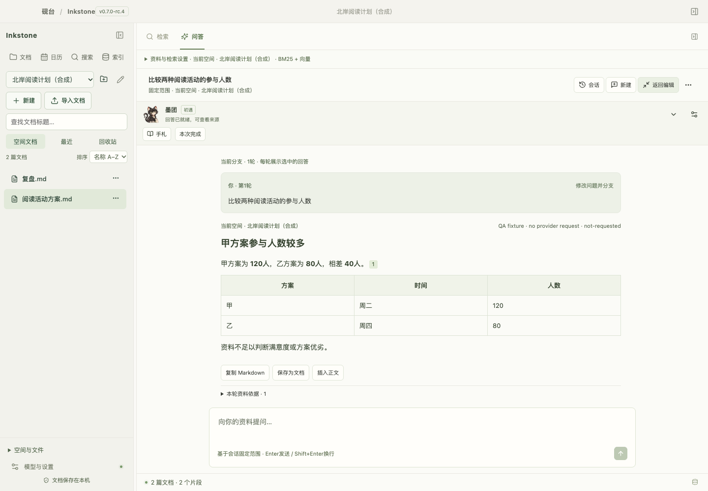
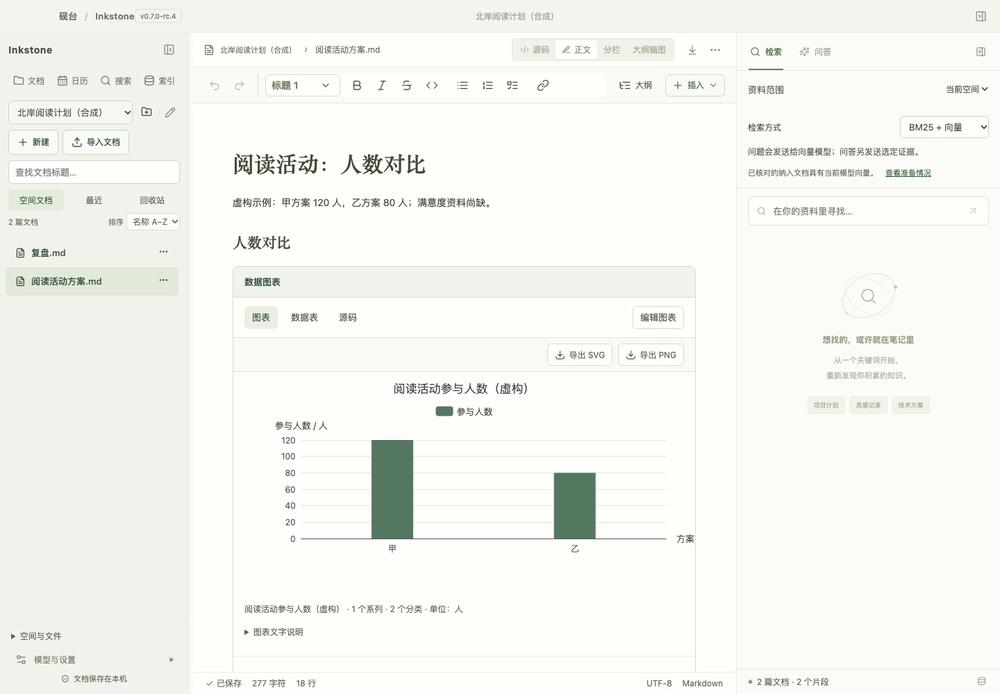
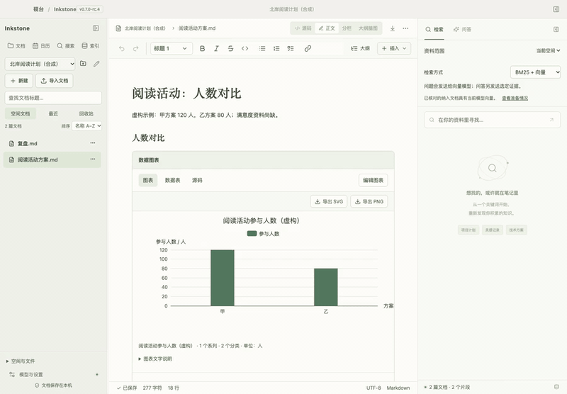

# 砚台 · Inkstone

**在 Mac 上编辑本地 Markdown，把选定资料整理成能核对原文的 Wiki。**

Inkstone 将 Markdown 写作、文档空间、Wiki 与独立 AI 问答放在一个 Mac 应用中。使用自己的模型 API，按本轮需要选资料，也可以选择让书房同伴陪你工作。

[English](../README.md) · [源码快速开始](QUICKSTART.md) · [后续计划](ROADMAP.md) · [公开版本](https://github.com/raistlinsha-plus/inkstone/releases)

**当前开发版本为 v0.8.4**，面向 macOS 13+ Apple Silicon。本版统一浅深配色，覆盖问答、文档、Wiki、设置、日历、同伴与图形预览。已公开的源码预览为 v0.8.0-rc.2。 [交付说明](DELIVERY-v0.8.4.md) · [公开版本](https://github.com/raistlinsha-plus/inkstone/releases)



截图及下方演示来自较早的 v0.7 界面，使用虚构资料和模拟回答展示文档与引用操作。

## 可以怎样使用？

- **整理自己的资料。** 从不同本地位置复制导入文档空间，保留原件；显式比较来源更新，保留历史与备份。
- **让 Wiki 回到原文。** 在受管理空间选定资料，按主题整理，查看最近变更，核对原文位置。关键词、可选向量和 Wiki 定位共同召回原文，重排可以单独配置。
- **直接提问，按需加资料。** 在独立 AI 问答里解释、翻译或改写，或为当前问题选择一个空间、文档或文本附件。配置并授权 Brave Search 后，模型可按题自动查公开网页。查看每轮来源，将有用回答保存为文档。
- **直接在正文表达结构。** JSON、Mermaid、脑图、日程与受约束的 ECharts 图表可在 Markdown 正文内呈现和编辑。
- **选择安静的同伴。** 墨团、砚舟、知微提供阶段形象、固定故事及 CG。确认工作经历后成长，墨团可在温和陪伴中启用轻动效。





## 开始试用

先准备 Apple 命令行开发工具、Node 24.14.0、npm 11.9.0 和 Rust 1.99.1，然后：

```sh
npm ci --registry=https://registry.npmjs.org
npm run desktop
```

第一次编译需下载依赖。启动后，用两份虚构阅读计划笔记练习独立提问、添加资料并打开原文。[快速开始](QUICKSTART.md) · [v0.7.3 演示](../examples/v0.7.3/README.md)

编辑和关键词检索无需模型。向量、Wiki 整理和问答使用自己配置的兼容模型 API，重排使用独立的 Cohere 兼容端点。文档、索引、Wiki、会话及同伴状态保存在本机。模型操作按用途发送问题、片段或选定资料，可能产生服务商费用。启用联网后，模型只根据当前问题规划搜索，Brave Search 接收通过规则校验的公开查询。密钥保存在 macOS Keychain。[安全策略](../SECURITY.md) · [联网范围](DELIVERY-v0.7.2.md)

`npm run bundle`生成独立本机应用；日常只使用 `/Applications/Inkstone.app`，构建与验收包临时保留，见[版本及资料管理](LOCAL-INSTALLATION.md)。当前为临时签名，不等同正式安装包发行。

## 当前边界与参与方式

真实 Brave Search 帐号、原生辅助功能、跨机安装和更大语料评测等待单独验收。独立问答支持 TXT、Markdown、JSON、MMD 文本附件。PDF/OCR、云协作、单轮跨空间选取资料和悬浮桌宠列在后续范围。[本地检索评测](../evals/v0.7.5/README.md)

欢迎提交虚构最小复现、可用性反馈和独立问答评测；不要上传密钥、真实资料或私人备份。[贡献指南](../CONTRIBUTING.md) · [已知限制](KNOWN-LIMITATIONS.md)。如果这个方向对你有用，也欢迎点一个 Star 帮助更多人发现。

源码采用 Apache-2.0，上游保留各自许可，包含未修改的 MPL-2.0 依赖；不能概括为“全部 MIT/Apache”。[第三方清单](../THIRD_PARTY_NOTICES.md)及角色资源来源说明保留当前复核边界。
