# Inkstone rc.2＋rc.3 回归审查与正式版判断

2026-11-06。对象为0.7.0-rc.3；承接rc.1的[历史审查](REVIEW-v0.7.md)，不覆盖历史失败记录。

**结论：可以进入v0.7.0正式版收口开发，目前不直接发布正式版。** F1–F6已修复并有回归保护；当前工作流可继续试用。剩余门槛集中在真实Mac交互、自然多日成长、最终素材和发行准备，避免再追加大功能。

## 1. 已关闭的六项缺陷

| 问题 | 当前结果 | 关键证据 |
| --- | --- | --- |
| F1 快速切空间丢问题 | 导航先独立刷写问答草稿；失败阻止切换 | App干净正文快速切空间/失败导航两种回归 |
| F2 接收前失败清空输入 | 接收确认后才清空相同输入，失败保留；后来输入不被晚确认覆盖 | App失败、接收确认/后续输入回归；图5 |
| F3 生成中草稿冲突 | 生成/草稿串行处理；失败保留重试，成功清理对应错误；回执异常先核对版本 | Hook并发、故障重试、较新草稿、回执丢失及App生成中退出回归 |
| F4 经历卡失败丢文字 | 成功后才关闭表单，失败保留可重试文字 | 经历编辑失败→重试成功回归 |
| F5 仅搜索最近200条 | 后端查询/分页、归档和空间约束 | Rust202条历史；UI后台查询/分页；浏览器205条旧题查询 |
| F6 首问“这份＋明确文档名”误澄清 | 固定单文档或明确当前文档名进入正常检索，保留当前指标及证据门控 | 真实Rust领域回归与原先缺项/旧hash/错误来源保护回归 |

另修复标题80字限制、冻结范围向量准备提示、外部目录经历页标题和官方日历样例。停止后的非空片段以stopped/cancelled持久保存；部分结果不会成为上一轮完整答案来源。当前分支与完整导出分别核对。

## 2. 十条用户路径

| 步骤 | 用户任务 | 健康状况与界限 |
| --- | --- | --- |
| 1 | 找空间、导入及查找文档 | 自动回归通过；本轮系统文件选择器未实操 |
| 2 | 正文/源码写作与工具栏 | 浏览器往返、编号与工具栏通过；中文原生候选待补 |
| 3 | JSON、脑图、Mermaid、图表、日历 | 结构呈现/编辑及官方日历契约通过；简单图示更紧凑 |
| 4 | 模型配置与范围核对 | 冻结范围提示已修正；真实服务连接本轮未重测 |
| 5 | 首问、多轮、生成与停止 | 针对性与协议桩流程通过；停止部分内容有明确未完成标记 |
| 6 | 查看引用、保存/插入回答 | 自动及合成浏览器流程通过；实际原生落文待补 |
| 7 | 历史、分支、归档与导出 | 后台查询/分页和分支导出已验证 |
| 8 | 角色、经历、故事与成长 | 经历失败恢复通过；多日节奏与最终美术待签收 |
| 9 | 窄窗、键盘、可访问性 | 六组布局与指定弹窗Tab/Escape通过；VoiceOver及系统缩放待补 |
| 10 | 备份、恢复、重开 | 自动兼容/语义校验、安装前真实完整备份与隔离冷启动通过；原生操作仍单列 |

## 3. 本轮截图与体验判断

截图只使用本轮隔离上下文、合成内容和真实React界面，不读取真实浏览器资料，不作为原生WebKit证据。接受的本地文件逐张检查；加载中截图不作为完成证据。

### 图1 窄窗问答

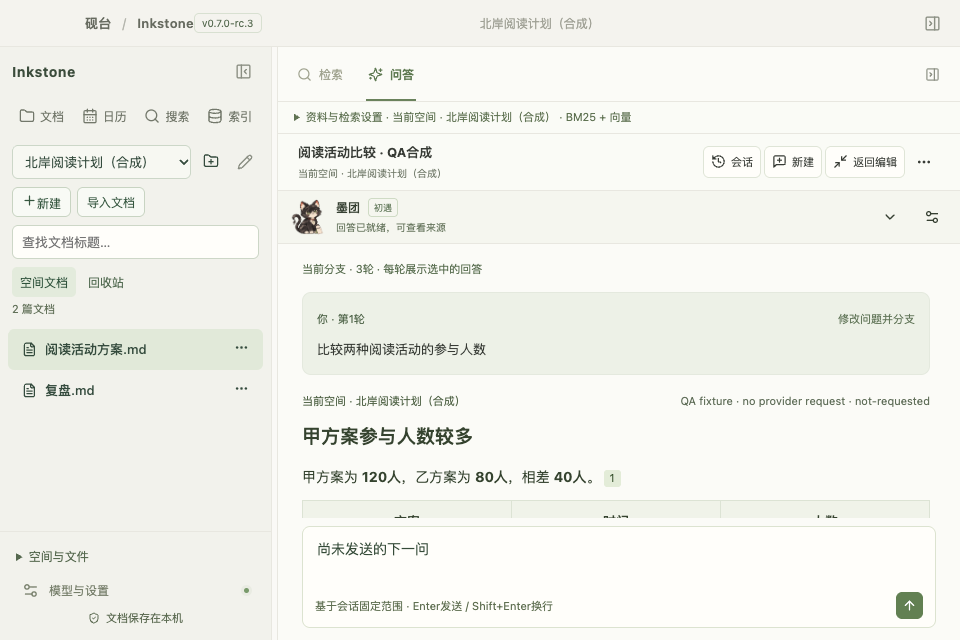

当前六组窗口没有横向溢出，发送按钮均在屏内；960×640的答案滚动区约274px，问答区宽约683px。960窗口按知识任务使用两栏，输入框保留独立左右留白和返回编辑入口；手动文档栏偏好不会被自动布局覆盖。长回答仍需要滚动，建议后续加入用户可调文字大小，并在真实Mac缩放下检查。

### 图2 JSON编辑

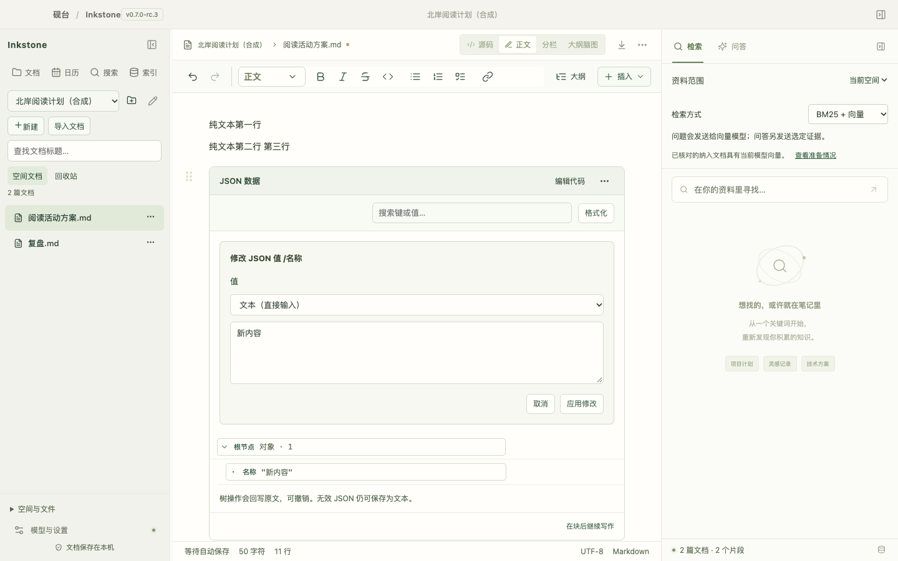

值标签、类型和输入形成统一左边界，应用与取消分组清楚。树和源码的高级操作保持原能力，默认不增加复杂表单。

### 图3 脑图与Mermaid

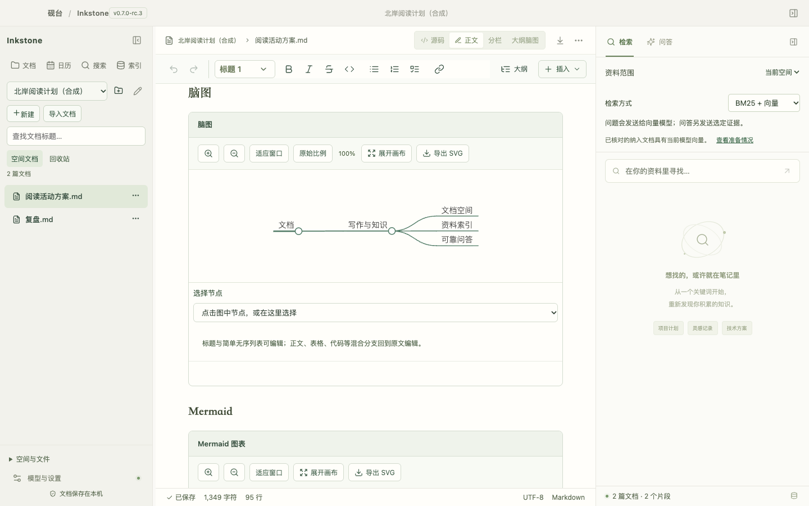

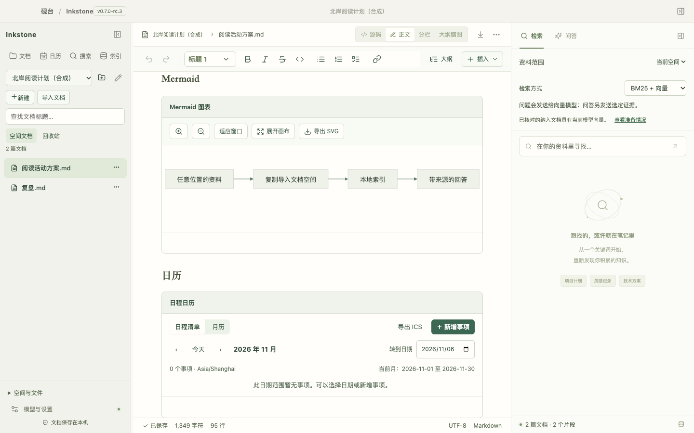

默认画布有上下界，简单图不再使用过高的固定区域；复杂图可展开。重置比例与实际缩放值区分，避免两个100%含义重复。图中合成“文档”根节点可继续优化为用户标题，属于非阻断细节。

### 图4 官方日历

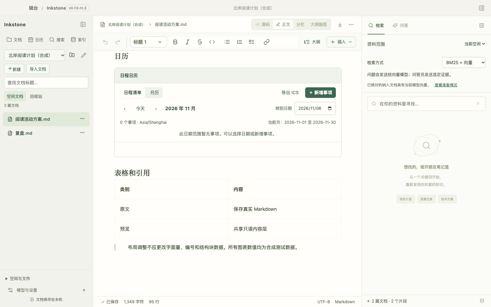

官方样例使用当前schema和稳定ID；空日历是合法状态，不能再以无效格式演示组件。测试覆盖examples中所有calendar围栏。

### 图5 失败恢复

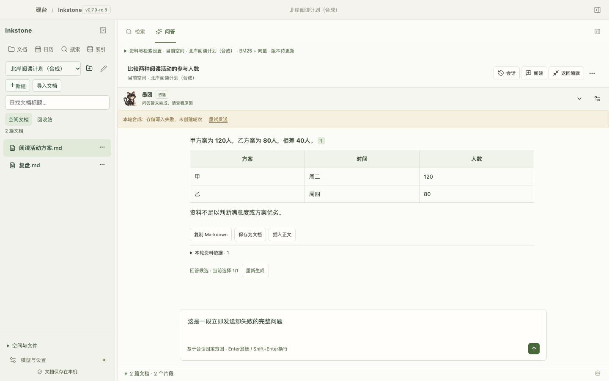

主动注入接收前存储失败，旧回答保留，新问题仍在输入框并可重试。实际事务失败由Hook/App及Rust域分别验证，浏览器截图仅证明呈现。

### 图6 历史与导出

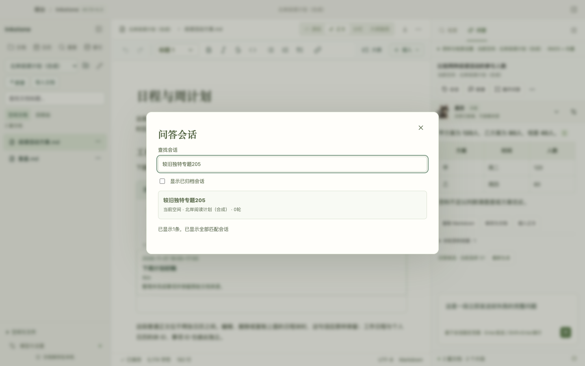

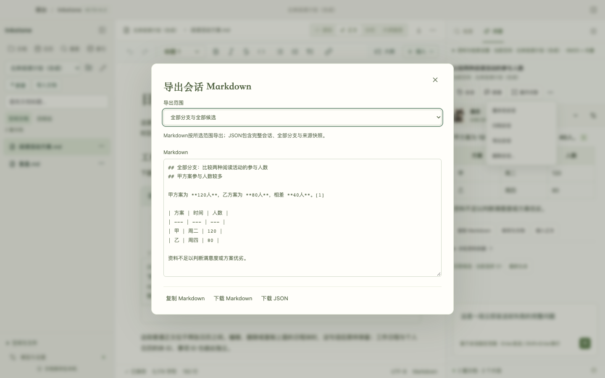

旧会话可通过后台查询找到；加载更多和显示范围清楚。Markdown当前分支只输出选中回答，全量保留问题标识/上级关系，JSON始终保持完整数据。

### 图7 其余关键路径

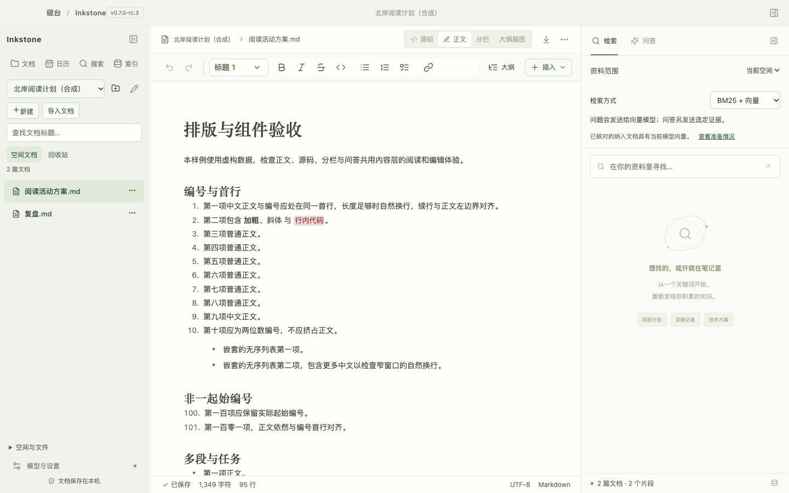

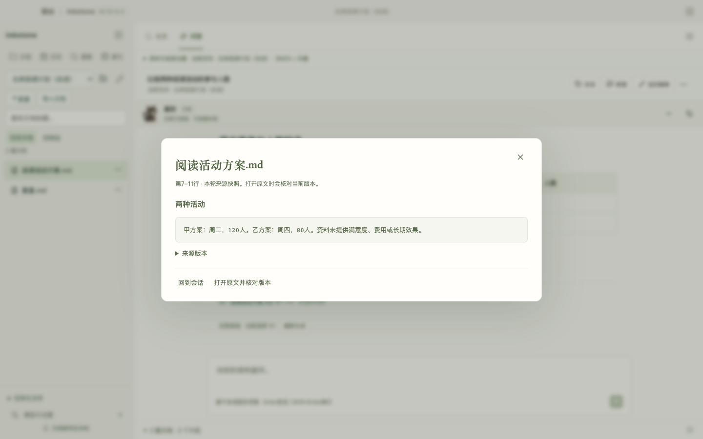

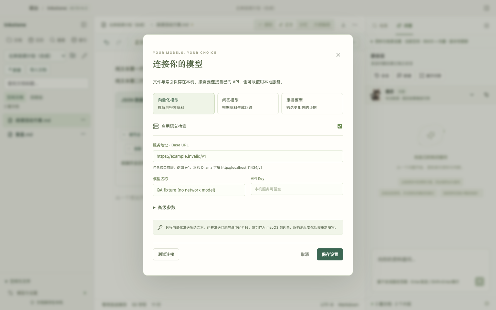

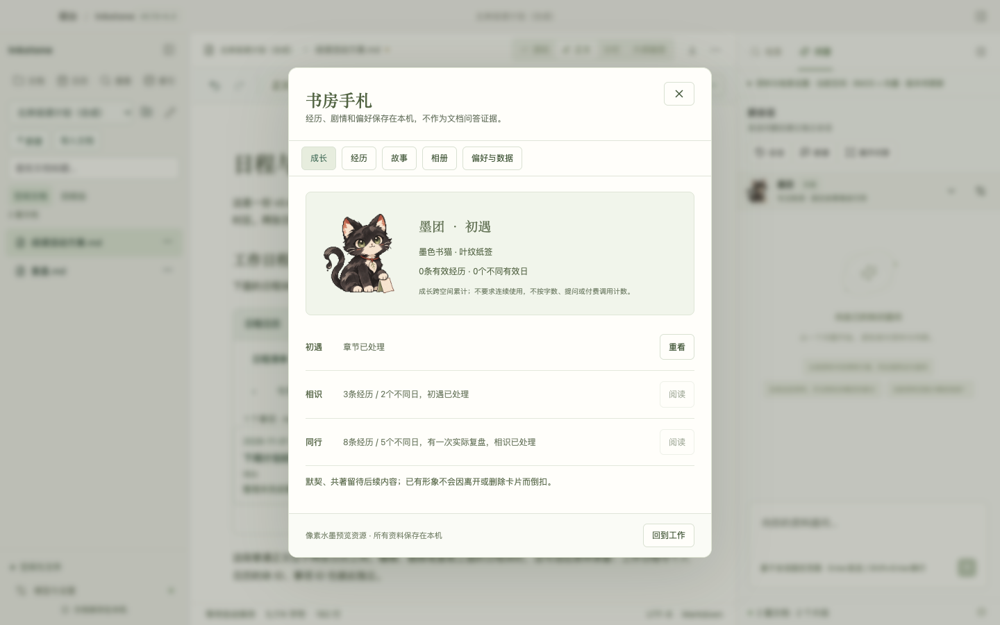

正文工具栏、编号、来源核对、模型分组与角色说明继续可用；原生输入、系统认证和多日体验仍按后文单列。

## 4. 检查结果与证据边界

最终fresh完整门槛通过：生产前端50文件274项、Rust169项通过/6项显式远程忽略，工具13项、原型44项通过；类型、Worker、生产前端构建及文档通过，最终耗时见本轮验证回执。最终完整默认检查、六组布局结果与本机安装回执分别保存在本轮artifacts目录。全量默认检查不使用resume；保留依赖与编译缓存，不代表干净机器构建。原型检查与生产检查分列。

- 浏览器：新隔离Chrome上下文，只访问本机回环和内置资源；合成IPC，0真实模型请求。覆盖首问/追问/拒答、来源、停止、再生成、草稿、重开、六组布局、结构块、旧会话搜索和导出范围。
- 后端：来源身份、当前指标、版本/hash、空间约束、取消流、停止部分快照、分支导出与备份语义均有针对性回归；不以截图替代事务检查。
- 原生：五次隔离进程启动到WebView bootstrap通过，系统凭据在该构建中禁用；只说明冷进程和IPC，不代表可见交互、中文输入、VoiceOver或真实API通过。
- 生产备份：使用产品完整备份函数，valid=true，issues为空；应用安装及生产启动另有私有回执，避免将隔离包当生产包。
- 可访问性：手札弹窗Tab留在弹窗、Escape关闭通过；辅助文字仍需系统缩放/读屏/对比度专项，不宣称全量无障碍合规。

验收脚本发生的旧标签定位失败及加载中截图均保留，修正定位/就绪等待后才接受最终证据，没有将其列为产品缺陷。

## 5. 剩余问题与正式版工作包

| 工作包 | 范围 | 正式发布前判定 |
| --- | --- | --- |
| A 原生验收 | 正文/源码中文输入、快捷键、系统导入导出、来源落文、重开恢复、VoiceOver | 按实际生产安装版逐项签收；失败保留复现并修复 |
| B 真实问答 | 三类API连接、首问/追问/缺项、流式停止与重新生成 | 小规模有预算冒烟；不重复已有付费语料，不以成功HTTP代替回答质量 |
| C 成长与资源 | 至少5个不同使用日的自然试用；像素水墨样片及既定素材终稿 | 确认不打扰、无误记/重复成长，素材来源/许可/小尺寸可读性签收；动画可后续 |
| D 发行收口 | 当前文档入口、旧启动入口、第三方声明及安装升级说明 | 源码稳定标签与正式二进制分开；跨机/签名/公证未满足时不宣称安装包发行完成 |

持续已知限制：生成期间新问题草稿排队到本轮结束或正常退出前保存，强制结束进程可能丢失未刷盘部分；称呼尚未应用；资源为静态候选；主JS包体仍有大块警告，应先测量再拆包；新语料RAG质量与首次配置引导继续后续专题。

**下一步仅开发A–D的收口事项，不同时增加新格式、角色、长期剧情或云能力。** 实际验收通过后再决定v0.7.0正式标签；发布行为另行执行。

导出保护：未完成或含待核对图表的候选在Markdown中保留为明确标记的源码围栏，避免重新绘制被拒绝的图表或让未闭合围栏吞掉后续问题；JSON保留原始响应。

退出补充复核：单文档范围下尚未发送的问题，在正常退出时继续按最新固定范围保存；已通过修复前失败复现和修复后回归。
