# Inkstone v0.7 用户体验审查与回归

2026-11-05。审查对象为0.7.0-rc.1，产品基线提交86496a0。

当前版本已经形成“本地写作—资料问答—显式保存结果—轻陪伴”的产品闭环，编号对齐、常用工具栏、结构内容和来源预览比早期版本更完整。正式版前应先解决输入与失败恢复问题：本轮定向探针确认六项功能缺陷；已有全量测试尚未覆盖这些交互组合。建议下一轮先做可靠性候选补丁，再做布局与陪伴细节，不扩大功能面。

## 1 本轮范围与证据

- 完整默认检查重新执行，不使用resume：47个前端文件260项、Rust164项、工具13项、原型44项通过；6项付费远程测试默认忽略。类型、Worker、生产前端构建和文档检查通过。总时长39.824秒，保留既有依赖与编译缓存，不代表干净机器构建。
- 真实React应用在全新隔离Chrome上下文中使用合成IPC；只访问回环地址，未读取真实浏览器资料。多轮、来源预览、停止、草稿、会话重开及侧栏/展开的1440×900、1280×800、960×640六组合检查通过；无横向溢出，答案滚动区最低约190/230px。
- 五个前端定向探针证明现有缺陷；另一个真实Rust领域探针证明首问路由误拒答。探针通过表示复现成功，问题未修复。
- 另一个Rust领域探针确认：改文档显示标题不破坏固定范围，来源原位更新保留ID/路径/标题，旧hash来源变化后追问会要求核对。此前的路径失效疑虑已排除。
- 本轮没有重新调用真实模型。候选开发时的2次真实服务请求只作为历史冒烟，不合并为本轮回归通过项。
- 桌面控制工具本轮不可用，内置浏览器在Work设置中禁用；本轮浏览器检查沿用用户已授权的本机无头隔离验收。原生WebKit、系统文件对话框、中文输入候选、Keychain授权、VoiceOver、跨机与自然多日成长均未补验。

## 2 用户路径检查

| 步骤 | 用户任务 | 当前健康状况 | 本轮证据与边界 |
| --- | --- | --- | --- |
| 1 | 找到空间、导入或寻找文档 | 部分通过 | 导航及列表呈现可用；实际项目文档同步采用产品领域API，最终回执另记；本轮未操作系统文件选择器 |
| 2 | 正文写作、编号和工具栏 | 较好 | 图1编号1/10/100与首行对齐，工具栏分组、侧栏与正文留白稳定；源码切回正文未复现早期原始Markdown块问题 |
| 3 | 在正文插入与编辑结构内容 | 部分通过 | JSON树/修改表单、图表、脑图和Mermaid可显示；JSON单标签对齐、简单图示高度仍需优化；一个仓库日历样例失效 |
| 4 | 配置模型、确认索引与资料范围 | 部分通过 | 配置层次可辨，说明保留本机/外发界限；本轮未用真实凭据测试连接，固定会话范围的准备提示有代码风险 |
| 5 | 首问、多轮追问、停止与再生成 | 有缺陷 | 正常多轮/候选可用；发送失败和生成中草稿有可靠性问题，明确单文档首问也可能误澄清 |
| 6 | 查看引用并把回答落入文档 | 部分通过 | 来源弹窗、快照/行号/核对版本清楚；浏览器合成流程通过，未把它计为生产资料写入验收 |
| 7 | 历史、分支、归档与导出 | 有缺陷 | 重命名与浏览器重开通过；超过200条会话搜索不完整；Markdown导出分支/候选关系不够清楚 |
| 8 | 选择角色、读故事、确认经历 | 部分通过 | 三角色和手札入口可见，后端成长与幂等有自动检查；经历卡失败会丢编辑，称呼目前只存档；自然多日成长未验 |
| 9 | 窄窗、键盘与可访问性 | 需打磨 | 六档无横向溢出，但960三栏压缩编辑与答案阅读；截图辅助文本偏淡/偏小，需补对比度与原生键盘/读屏实测 |
| 10 | 备份、恢复与重开 | 自动检查通过 | 格式2及旧格式兼容、两辅助库语义验证有Rust回归；本轮未走系统保存器和最终原生应用重开 |

## 3 已确认功能缺陷

P2高应在下一个候选中优先完成；此处没有把它们算成已修复。

| ID | 优先级 | 复现步骤与实际结果 | 用户影响与改进验收 |
| --- | --- | --- | --- |
| F1 | P2高 | 正文已保存时，输入问答草稿，600ms内切空间再回来，输入、草稿、会话均为空 | 普通导航丢问题。切换前独立刷问答草稿，失败保留原空间输入；不依赖正文dirty状态 |
| F2 | P2高 | 快速输入立即发送，让后端begin前发生存储失败；输入先被清空，未创建轮次且草稿为空 | 无法直接重试原问题。持久接收前保留待发原件，失败恢复且不覆盖后来输入 |
| F3 | P2高 | 回答仍在生成时输入下一问，等600ms；旧会话revision触发草稿冲突，生成/后续保存成功后警告仍残留 | 不知道草稿是否安全。草稿独立版本或串行合并，成功后清理对应错误；测试中途退出 |
| F4 | P2高 | 手札经历卡编辑后保存，让异步写入失败；表单立即关闭并显示旧文案 | 修改文字丢失。等待成功再退出，失败保留可重试表单，并防重复提交 |
| F5 | P2中 | 同空间超过200条会话，历史中搜索更旧独特标题；仅在最近200条本地过滤 | 数据还在却显示无匹配。调用后端query，增加分页/数量/截断提示，覆盖归档组合 |
| F6 | P2中 | 固定单文档青禾方案.md，新会话首问“这份青禾方案的报名人数是多少？”本地澄清；去掉“这份”可检索 | 常用自然问法失效。先解析明确文档名和固定范围，再识别追问；保留当前属性门控 |

实现定位：F1 `App.tsx:801`与`assistant/useAssistant.ts:37–69`；F2 `App.tsx:2030/2089`与`useAssistant.ts:166`；F3 `useAssistant.ts:131/178–189`；F4 `companion/ExperienceJournal.tsx:69–70`；F5 `ConversationHeader.tsx:176–193`与Rust `assistant.rs:265`；F6 Rust `assistant_grounding.rs:23–47/142–143`。

补充代码确认的问题：会话重命名UI允许100字而后台限制80字；单文档会话的向量准备提示可能按后来打开的另一文档计算；外部目录经历页显示所有空间卡片却仍称当前空间；称呼字段尚未应用于问答/固定台词。停止后后台保存stopped但不保留已流出正文，建议作为未完成回答保留并明确标记。以上优先级为P3或产品取舍，原生实际行为仍须补验。

## 4 截图与体验判断

以下均为本轮截图，资料为合成，模型响应为夹具。不使用此前版本截图作为当前体验证据。

### 图1 写作与文档列表

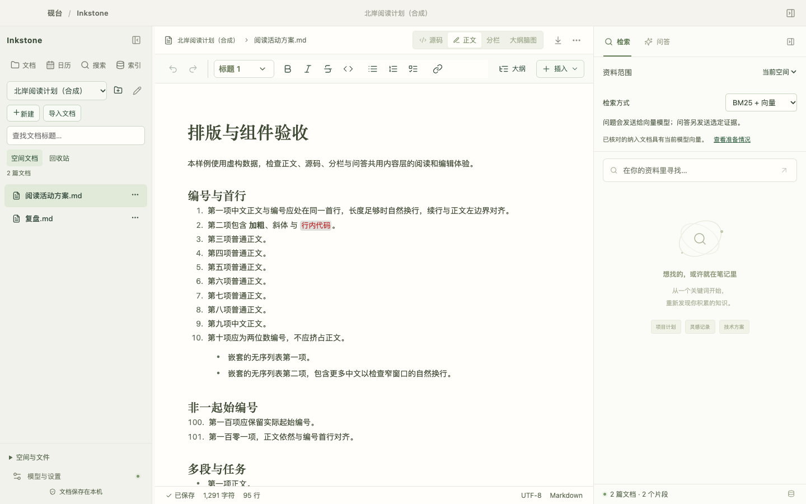

编号1、10、100和中文首行对齐；左侧列表已独立获得可用区域。工具栏图标的尺寸和分组比早期清楚。正文与界面大量小字号并存，建议将辅助说明、状态、工具提示形成统一字号层级；图标需要稳定的悬停说明和快捷键提示。列表规模大时还需要分组/层级与来源更新状态，避免版本资料平铺。

### 图2 JSON编辑

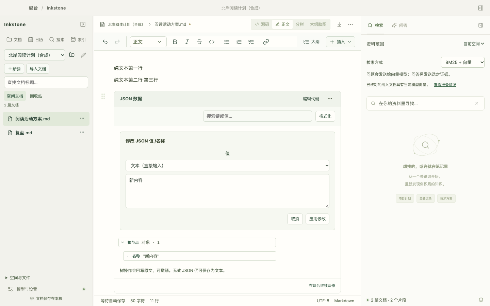

字段边界、输入区、应用/取消动作清楚；“值”标签居中，而字段标题和文本输入左对齐，阅读轴线仍不一致。建议统一表单标签左对齐，并将只读树、正在修改字段与源码入口的层次进一步明确。字号/密度偏小的判断需要配合原生缩放实测，不能仅由截图断言无障碍不合规。

### 图3 数据图表

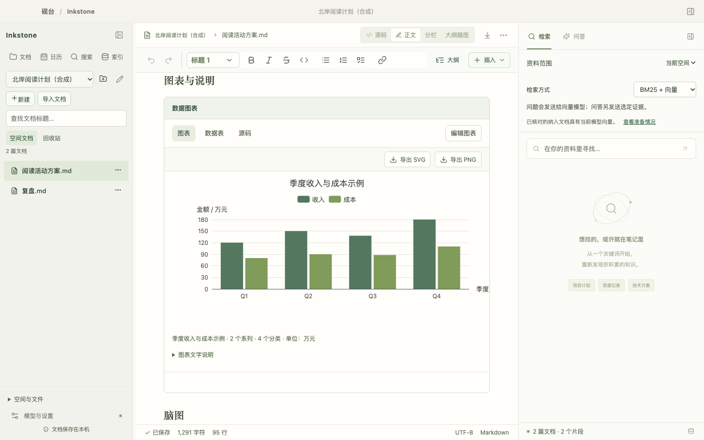

标题、单位、图例和说明均有独立留白，过去说明贴边问题在正常图表中未复现。图表工具、通用块标题和视图切换共占多行，可减少重复标签；应区分常用编辑动作与低频导出。真实数据语义与引用仍需核对，本轮不对模型图表准确率作新结论。

### 图4 脑图与Mermaid

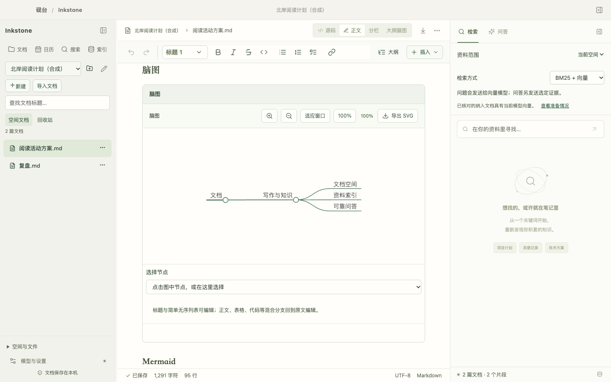

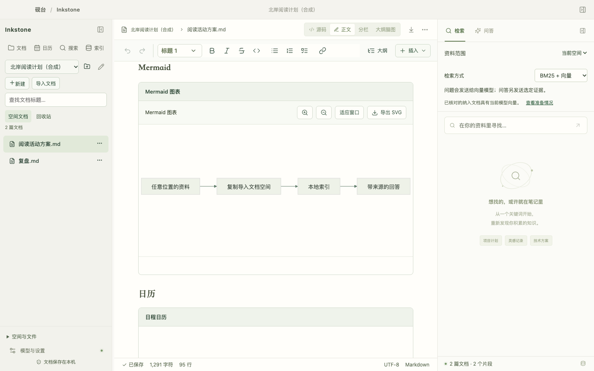

当前脑图默认字体未见早期异常偏大。简单四节点图仍使用很高的固定画布，内容只占中间一小段，拉长文档滚动；脑图有重复的100%状态，块类型标题也重复。建议按内容高度设置有上下界的紧凑默认，复杂图主动展开，合并缩放状态和重复标题；缩放后保留一键适应。

### 图5 日历样例错误

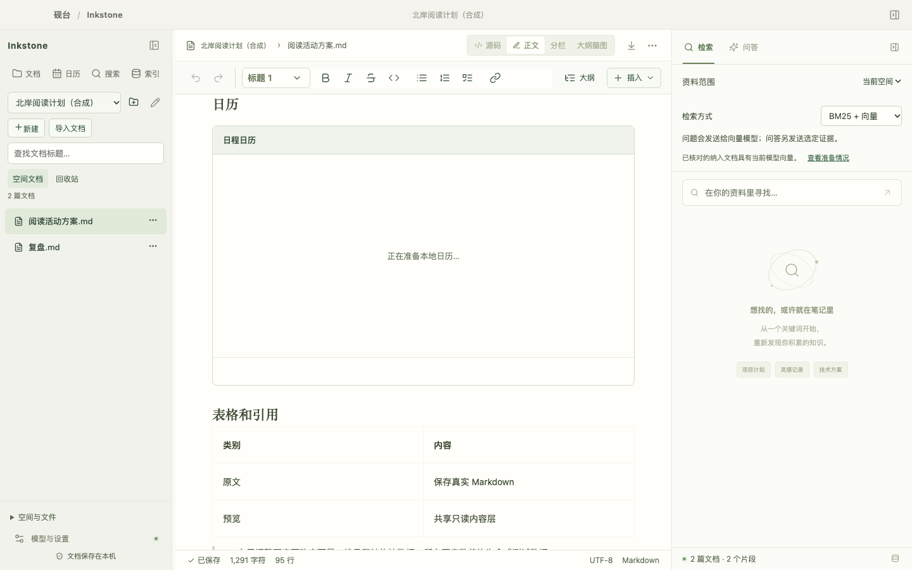

`examples/v0.6/排版与组件验收.md`中的日历使用`schemaVersion:1`，缺少当前要求的`schema:"inkstone.calendar/v1"`及ID，出现“无法识别日历格式版本”。这是项目样例与当前契约不一致，不能据此判定合法日历整体失效。合法的v0.4日历样例在当前11月显示1条事项，已独立确认正常渲染。错误区文字贴卡片左边，与正常块的内边距不同。建议更新样例、对所有官方围栏做契约检查，并统一错误态间距及“编辑代码”就地修复入口。

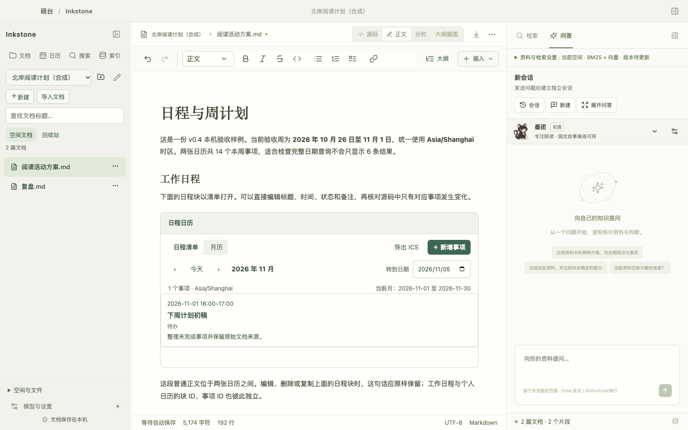

### 图6 问答与来源

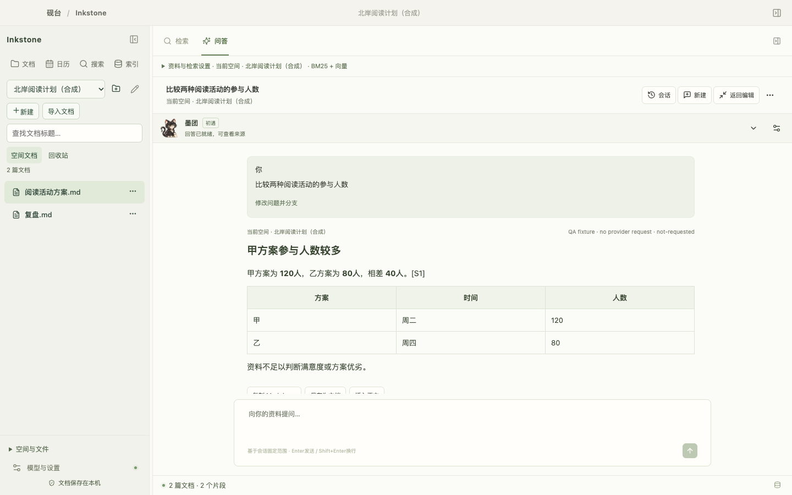

会话、问题卡、正文、来源及落地动作已形成可读层次；来源弹窗明确区分本轮快照和当前原文。仍需让“当前分支/当前候选/正在生成”的位置更稳定，停止保留未完成文字，失败就地重试并保留问题。引用入口不宜只依赖底部折叠区；长答案应支持点击正文引用后就近查看，再返回原阅读位置。

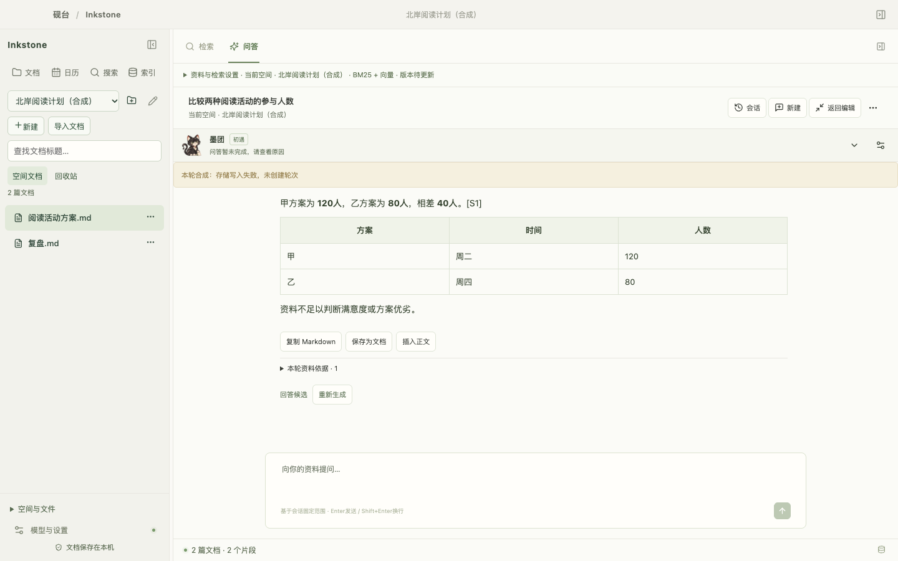

上图为主动注入存储失败后的真实前端呈现：旧回答仍在，但本次未发送问题已从输入框消失，与F2探针一致。

### 图7 窄窗问答

三栏没有横向溢出，但左栏约272px、右栏380px后，编辑区只剩约308px。问答顶部配置/标题/动作/同伴加输入框压缩答案，当前190px答案滚动区可一次主要看到问题卡，正文需继续滚动。这属于任务效率问题，不能以无溢出等同体验通过。建议窄窗默认按任务切换为两栏，打开展开问答时可临时收起文档栏；保持可撤销的手动布局选择。

### 图8 角色与偏好

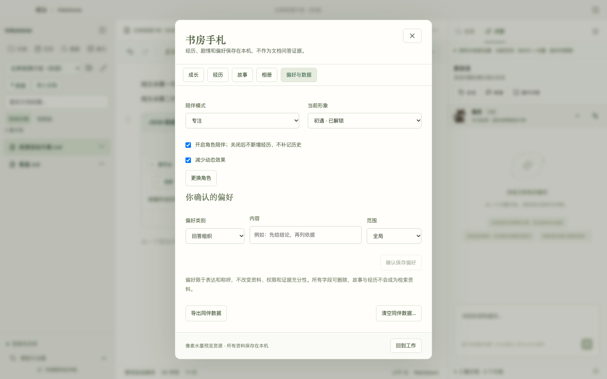

角色配色、纸张/书签道具和Inkstone书房风格一致，关闭与减少动态可见。但当前更接近水墨配色的动漫插画，缺少明确像素网格与动作，暂时无法形成类似虚拟宠物的持续存在感。角色选择插图和书房手札承担主要体验，工具状态头像偏小。建议先把墨团做成小尺寸原生像素定稿与少量工作状态动作，再延展人形；不要先增加更多剧情数量。称呼尚未生效应明确标注或暂时收起，减少承诺落差。

手札成长页的12次Tab均留在对话框内，Escape关闭通过；这只覆盖此浏览器流程，不代表原生读屏/所有弹窗通过。

### 图9 模型设置

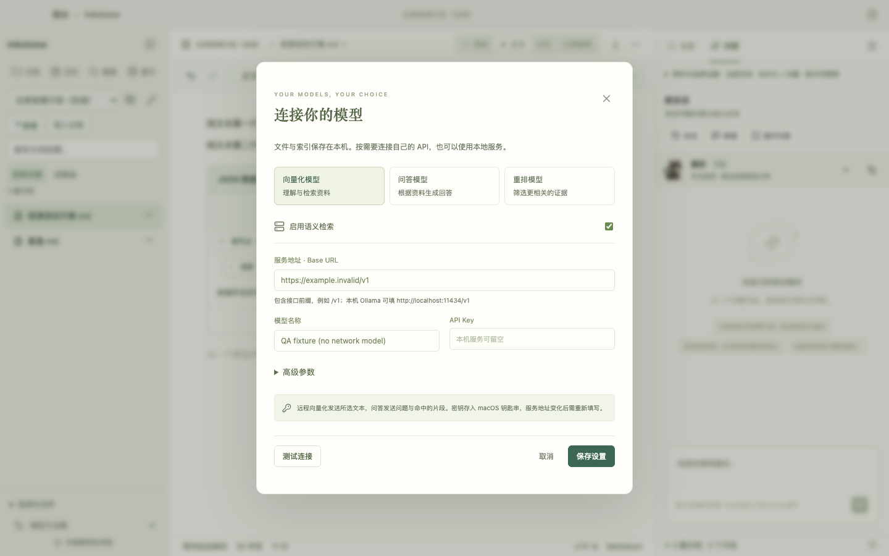

向量、问答、重排三类配置比混在同一表单更清晰。新用户仍需理解建库、当前索引准备情况、关键词/混合差异和服务错误。建议提供一个连续的首次配置路径：测试问答连接→导入合成样例→本地关键词首问→自愿启用向量与重排；高级参数保持折叠。前次系统认证等待问题不能只靠保存口令解决；需要稳定签名、集中授权、隔离测试和免认证默认回归。

## 5 发现清单与优先级

| 范围 | 待改进项 | 优先级 | 具体通过标准 |
| --- | --- | --- | --- |
| 输入可靠性 | F1–F4问题/草稿/经历编辑的失败恢复 | 下一候选优先 | 切空间/生成/IPC失败/退出组合中，输入有明确可恢复归属，错误可就地重试 |
| 问答可用性 | F5历史搜索、F6首问对象识别 | 下一候选优先 | 201条以上按后台标题查找；“这份+明确名/固定单文档”正常检索，缺预算仍拒答 |
| 会话理解 | 分支/候选、停止、导出 | P3 | 标出活动分支，停止保留未完成文字，MD导出区分当前分支与全部记录 |
| 窄窗与结构块 | 两栏任务模式、图高度、重复工具行、表单对齐、错误内边距 | P3 | 960窗口完成读答和编辑无需反复找正文；简单图高度与内容匹配 |
| 文档资料 | 官方日历样例、当前说明/历史资料、重复导入管理 | P2/P3 | 官方样例无契约错误；当前版本文档可一跳找到；来源更新明确保留两份原因 |
| 角色 | 称呼兑现、墨团像素定稿与工作状态、成长解释 | P3 | 展示的设置确实生效，缩小后清晰，动作尊重减少动态和专注模式 |
| 无障碍 | 字号/对比度、焦点、读屏、中文候选 | 正式版门槛 | 按本机键盘/VoiceOver/中文输入逐项实测，不由截图推断全部通过 |
| 性能 | 首屏与按需加载 | 先测量 | 构建主JS约2.56MB有警告；先测启动/内存/长文/大量会话，再决定拆包 |

## 6 建议后续版本

1. **v0.7.0-rc.2可靠性**：仅处理F1–F6、标题长度/固定范围提示，以及本轮官方样例错误。每项先保留失败用例，修后跑针对性与一次完整检查。保持事实证据门控。
2. **v0.7.0-rc.3体验**：窄窗任务布局、结构块紧凑高度、表单/错误态间距、停止保留部分回答、当前分支导出、当前文档入口。用相同内容和尺寸前后截图比较。
3. **v0.7正式候选签收**：真实Mac一次集中回归，包含系统导入/导出、中文候选、键盘/VoiceOver、旧资料升级、问答/角色重开、备份新目录预演、真实API三类配置。完成五个不同使用日自然成长及资源终稿签收，再决定正式标签。
4. **v0.7.1陪伴深化**：先墨团小尺寸像素水墨和少量状态动作，明确称呼/表达偏好可用范围；经历分页，减少成长解释负担。人形动作和桌面悬浮另立范围。
5. **后续RAG质量**：冻结一套此前未见、含抽象改写/指代/相似文档/缺项的合成或获准资料，对BM25、混合、混合+重排分别看证据覆盖、拒答、引用、耗时和实际请求预算；不把相关性分数当答案正确率。

## 7 本轮回归覆盖的明确缺口

默认检查通过只说明现有检查覆盖的行为通过，不能抵消F1–F6的针对性失败事实。本轮图示/日历检查存在多次测试脚本定位失败，均属于验收脚本问题，原始失败保留；修正定位与等待后接受最终截图，不把这些计为产品缺陷。

生产文档同步采用现有来源预览/更新、复制导入、历史和完整备份领域函数，原件及无法安全覆盖的旧副本保留。仓库副本一致、生产领域读取通过和原生界面重开是三个不同检查；最终数字、未导入项和异常以单独同步回执为准。
