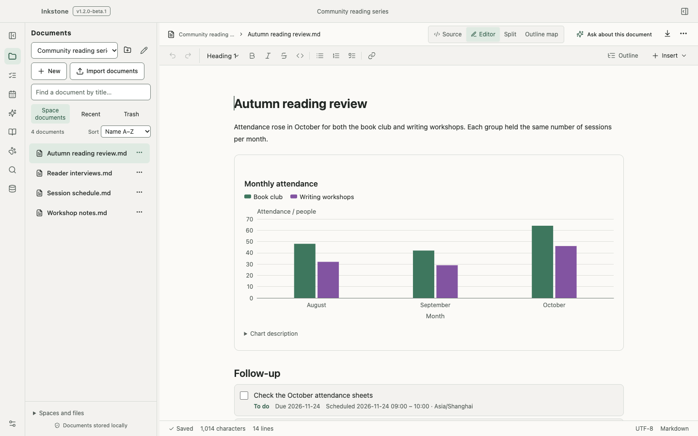
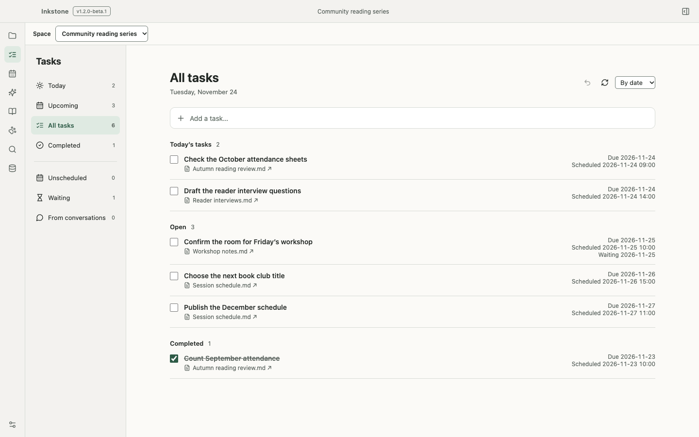
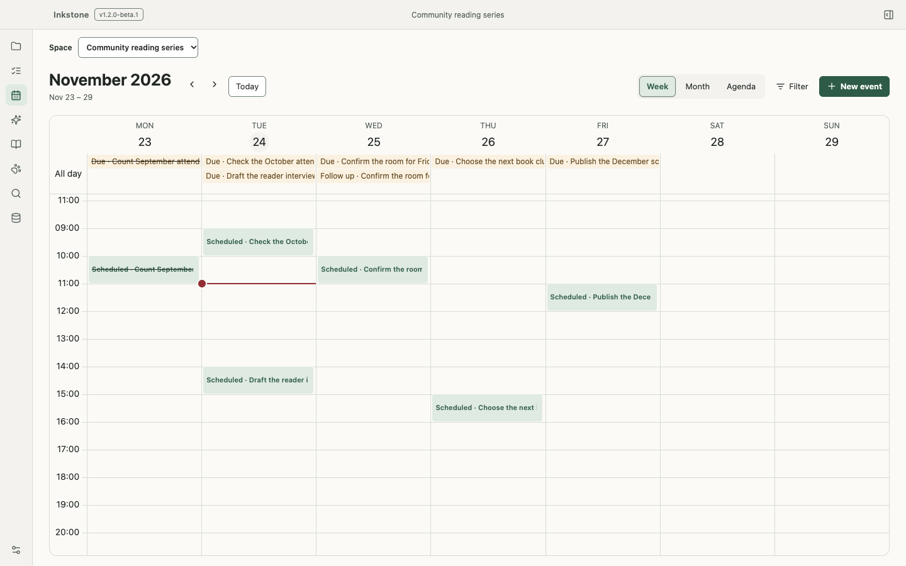

# Inkstone desktop guide · v1.2.0-beta.1

[简体中文手册](USER-MANUAL.zh-CN.md) · [Build from source](QUICKSTART.en.md) · [What changed in this beta](DELIVERY-v1.2.0-beta.1.en.md)

## Try a note first

Open **My documents → From sources to your first answer → Try the example**. This creates a separate sample space. Its notes contain Chinese text. Search for `阅读活动` (reading activity) and open a result to jump to the original passage. In **Offline chat walkthrough**, choose **Try sample chat**, open a citation and save the sample answer. This exercise uses a prepared answer and works without a model key. Switch back to your own space when you are ready.

## Start writing

Open **My documents** and select a space. A space groups documents from different places on your Mac. Choose **Import documents** to copy a file or folder into the active space. Edits go into the copy. To edit files in place, open **Spaces and files → Open local folder (edit originals)**.

Create a Markdown note with **New document**. Use **Editor** to format text, **Source** to edit Markdown, or **Split** to compare both. The insert menu supports lists, tables, JSON, Mermaid, charts, mind maps and calendars. Hover over a Mermaid diagram or mind map, or Tab to its controls, to zoom, fit or export an SVG. Tall Mermaid diagrams expand with the document. Save with ⌘S. Use a document’s menu to inspect its history or check whether an imported original has changed.

### Work with a data chart

1. Import the [sample note](../examples/v0.6.6/首发体验.md) and open its chart, or use **Insert** to create a data chart in a Markdown note. In **Editor** and **Split**, hover over the chart or Tab to its toolbar.
2. Switch between **Chart**, **Table** and **Source**. Check the category, series and unit before comparing values. An empty cell represents missing data.
3. Choose **Edit chart** to edit the data, then **Apply chart changes** and ⌘S to save the note. Return to **Chart** to export SVG or PNG. **Chart description** opens a text version of the values. To edit a chart in a model response, first save the answer as a document.

## Choose your languages

Open **Models and settings → Language / 语言**. Choose **Use system language**, **简体中文**, or **English**. The setting takes effect immediately. The current calendar and schedule continue to use their own time zones. Imported documents, prompts, citations, Wiki pages and previous answers keep their original text.

New installations match supported languages in the system’s preferred order and fall back to English. Upgrades with existing Inkstone browser preferences retain Simplified Chinese until you choose another language. macOS file pickers and system dialogs follow the system. Provider errors and older saved status messages may appear in their original language.

Open **Answer preferences** to select an answer language for one space or globally. The default follows your question. A request such as “summarize this in English” takes priority. Citations preserve the original passage. A provider’s performance on cross-language retrieval depends on the selected model and available evidence.

## Ask about sources

1. Import a note, open its space and choose **Source index**. Keyword indexing works locally. Add an embedding service in **Models and settings** if you want semantic retrieval.
2. Open the note and choose **Ask about this document**, or use **AI chat → Add sources** and select only the files or space you need. For an ordinary conversation, leave sources empty.
3. Connect your chat provider in **Models and settings** and send your question. Open a citation to read the source and check its version. Choose **More answer actions (…) → Context for this turn** to inspect which services were called, character counts, sources in the final request and citations used. Token counts appear when a service supplies them. Older conversations may have no request record.
4. Use **Save as document** to preview the Markdown and choose its destination. Saving an answer or importing a file never silently changes the external original.

Embedding, reranking, chat and web search can use the providers you configure. Their settings explain what text they receive. To restrict a turn, disable web search or remove sources before sending. Local keyword search is available without an API key.

**Check independent claims.** For “When does the library close, and when does the talk start?”, open the source for each time. If only one is supported, add a relevant note or leave the other item open. For a follow-up, name the event if the previous turn discussed several. Under chat model settings, **Verify candidate passages with the chat model** optionally sends up to eight candidate passages (4,000 source characters) for one additional request per turn when local evidence is insufficient. Turning off public web search controls a separate service.

**Share an answer.** Use the icons below it to copy Markdown or save a note. Use **Regenerate** to retry from the chat workspace. In the document sidebar, it is under **More answer actions (…)**. Enter sends your question, Shift+Enter adds a line, and Enter confirms the current candidate while a Chinese input method is composing.

**Save or migrate a service key.** Enter an API key in the settings for chat, embeddings, reranking or Brave Search and choose **Save**. For an existing installation, select the service at its saved address and choose **Import from old Keychain**. If macOS asks for your login keychain password, **Allow** is sufficient for that read. Import saves the key immediately. Repeat for each service you use. You can also enter the key directly. To retry a failed answer, choose **Regenerate** under the original question.

Inkstone stores these keys in `~/Library/Preferences/local.inkstone.desktop/credentials.json` with owner-only file permissions (`0600`). The file contains the keys in plaintext and can be read by programs running with your account’s permissions. Treat it as private. Normal chat, indexing, Wiki generation and search read the local configuration. The portable space backup omits the keys.

## Track work in Markdown

Hover over a navigation icon or Tab to it to read the label. Use **Tasks** to see tasks across the current space. Click the plus or **Add a task…**, type a title and press Enter or choose **Add**. The field is ready for another task. Tasks captured in **Today** are due today, and tasks captured in **Upcoming** are due tomorrow. Capture a task in **All tasks** to leave its date open.

The first quick capture creates **Tasks.md** in that space unless you select an existing note under **Save to**. Renaming the default note keeps future captures linked to it. The built-in space is **My Documents**. In a note, use **Insert → Task** to add a tracked checklist item. Check it off in the editor or in the task list. **Stop tracking** keeps the ordinary Markdown checklist item.

Open **Calendar** in the main navigation to see the week. A due date marks the deadline. A follow-up date marks when you want to check back. Both appear in the all-day area. To reserve time to do the work, open the task, choose **Schedule a time slot**, set start, end and time zone, and save. Drag the block in the week grid to change the schedule while keeping its deadline. Click the task’s source document to return to its line. All three views read the same Markdown task.

### Turn a conversation into a task

1. On your own message use **Create tasks from the original message**. For an answer, choose **More answer actions (…) → Create tasks from answer**. Select the sentence that describes the work, then choose **Add selection**.
2. For a long message, **Extract with chat model** can propose actions. By default the request includes the displayed message. When extracting from an answer, select **Include my question in extraction** to send the question too.
3. Review the proposed actions, change their titles or deadlines, select a destination space and Markdown note, then choose **Save to note**. If the note changed during review, reload it and check the destination before saving.
4. Open the task in **Tasks** to set a deadline or schedule. **Break down with AI** prepares a draft question you can edit before sending.

## Maintain a Wiki

Open **Knowledge Wiki**, select the documents allowed for compilation and save the scope. To change several sources at once, filter the list and select or clear all matches. Documents outside the filter keep their selection. Compilation sends the selected source material to the configured model. Open **Review and changes** to compare a candidate with the source excerpts. Publish, reject or, where available, publish only the verified excerpts. Published topics link to their sources. Recompile when a source changes. To remove a source, choose **Review items to clear**, inspect the affected topics, revisions and pending changes, then **Confirm save and clear**. The original document stays in its space. Changing the interface language alone does not rewrite a Wiki.

## Read with a companion

Open **Study companion**, select a character, and choose a chapter. Season one offers three chapters for each of Motuan, Yanzhou and Zhiwei. You can change languages mid-chapter and return to the same passage. Choices, unlocked art, confirmed experiences and growth belong to the same local character profile in both languages.

Click the desk pet for its actions or expand the explanation to see why the current pose was chosen. Set **Reduce motion** or enable focus mode for quieter reading. Use the journal to inspect confirmed experiences. Experiences and story dialogue are separate from the sources attached to your questions.

## Use local sources from another tool

In **Models and settings → External tools**, choose one space and create a read-only connection. A local tool can use `inkstone-cli` to search the prepared keyword index and read cited lines from that space. The CLI uses its own revocable connection token. In the source checkout, build it with `cargo build --locked --release --manifest-path src-tauri/Cargo.toml -p inkstone-cli`. Run `src-tauri/target/release/inkstone-cli --help` for its commands. [Pairing and query examples](EXTERNAL-TOOLS.en.md)

## Back up and recover

Open **Spaces and files → Backup and restore rehearsal**. Create a backup, verify its manifest and test restoration in an empty folder. Keep the verified archive separately. Configure service keys separately after restoring to a different Mac. Use the document trash to restore a removed copy or review the impact before permanently deleting it. Use **Recovery and diagnostics** if an import or file operation was interrupted.

## When a result looks wrong

| What you see | What to check |
| --- | --- |
| Search finds a note, but the answer lacks evidence | Open the citations and check the selected scope. For hybrid retrieval, use **View document index** to check that the note has a current index. |
| A Wiki topic misses a conclusion | Review the allowed sources, pending changes and dated excerpts. Add or update a source and compile it again. |
| A task is missing from this week | Open **All tasks**, check its due date, follow-up date, time slot and time zone. Tasks with no dates appear in the task list. |
| A desk pet stays still | Check focus mode and Reduce motion, including the macOS setting. Widen the editor if the pet is docked as a bookmark. |
