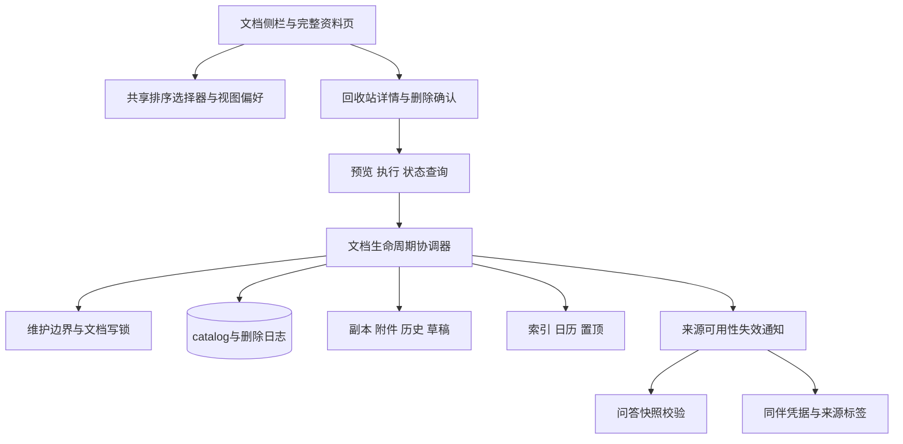

# v0.7.0 正式版技术方案

这是增量设计，生产基线 catalog schema3、assistant schema1 与独立 companion 库继续保留。React/TypeScript、Tauri 2/Rust、SQLite 和现有 Markdown/检索组件复用，不增加服务器、游戏引擎或向量数据库服务。

## 1 责任边界

排序是纯选择器，opened 与 updated 分开。删除是后端生命周期服务，不能把 `remove_dir_all` 放进 UI 或把改 status 当成物理删除。现有 `maintenance::mutation` 是普通写入许可，**不是全局独占锁**；实施时须新增与备份互斥的维护操作入口，不能假设现有许可已经覆盖所有竞争。

## 2 模块工作单

| 文件/模块草案 | 职责 |
| --- | --- |
| src/library/selectors.ts | 名称自然比较、稳定 tie-break、置顶/最近/回收站筛选 |
| src/library/viewPreferences.ts | 每空间偏好、读写失败提示、版本校验 |
| src/library/DocumentList.tsx | 稳定 key、滚动锚点、选择与 focus 恢复 |
| src/library/TrashDetail.tsx、PurgeDialog.tsx | 只读摘要、影响范围、确认和状态 |
| src/platform/ipc.ts | 生产现有类型边界中的增量命令；不要复制第二套裸 invoke |
| src-tauri/src/library/lifecycle.rs | preview/execute/status/recover；路径清单与阶段机 |
| src-tauri/src/library_commands.rs | 参数、空间授权与薄命令封装 |
| maintenance.rs、documents.rs | 维护独占、排空在途写入、文档锁、后台任务 admission |
| assistant_grounding / companion | 失效来源、未确认凭据、来源标签处理；事实快照与用户文字保留 |

模块名为目标布局，按现有类型目录核对后实施。先抽选择器且行为不变，再改排序；不同时搬动 App 全部控制器和删除业务。每个提交是可单独审查的业务单元。

## 3 排序数据与迁移

复用 catalog preferences，键 `library.view.v1:{spaceId}`，值 `{version:1,sort:'nameAsc'|'nameDesc'|'updatedDesc',pinnedCollapsed:false}`。只允许当前空间合法枚举，JSON 损坏回退默认并提示；写失败保留当前内存体验并告知“本次排序尚未保存”。宽度继续用原有设置，不发明重复字段。

比较器必须是全序：`Intl.Collator('zh-CN',{numeric:true,sensitivity:'base'})` → 当名称相等时按 `id`；修改排序用 updated DESC → 名称 → id，绝不能再依赖后端输入顺序。最近用 opened DESC → id，opened=0 排除。排序选择器无副作用。后端可保留 list 既有排序，但前端所有消费点必须显式排序，不使用“数组第一个＝当前文档”。

catalog 拟迁移到 schema4：documents 增 `trashed_at INTEGER NULL` 与 `lifecycle_revision INTEGER NOT NULL DEFAULT 0`；状态允许 `purging`。新增 `document_purges` 持久日志，不给它到 documents 的外键，避免删主行后丢失恢复状态。正文保存、改标题、源更新、恢复版本、trash/restore 均推进生命周期 revision，preview 以它和目录清单 digest 检测过期。

旧 trashed 文档的真实删除时间不可还原，保留 null，UI 显示“升级前已移入”；不把 updated 当成准确删除时间。迁移前沿用 SQLite 一致快照备份，失败不升级；新 schema 被旧应用明确拒绝。用户自行降级须从备份复制到新目录验证，不直接打开新库。

日志字段：operationId、documentId、projectId、phase、expectedRevision、manifestDigest、相对路径清单、各步骤完成位、错误码、创建时间。暂存期间可含恢复所需元数据，完成后清除内容与路径清单，仅保留 operationId/result 的短期状态回执；禁止记录正文或密钥。没有数据级事务能同时覆盖文件删除和这些独立库，因此采用明确阶段日志。[SQLite 原子提交说明](https://sqlite.org/atomiccommit.html)的事务保证不能扩展成对任意应用文件系统操作的保证。

## 4 命令契约

| 命令草案 | 输入 | 输出 |
| --- | --- | --- |
| library_set_view | projectId、version、sort、pinnedCollapsed | 已保存偏好 |
| library_trash_detail | projectId、documentId | 标题、状态、删除时间、专属附件/历史、字节数或 unknown |
| library_purge_preview | projectId、documentId | previewToken、expiresAt、revision、manifestDigest、影响摘要 |
| library_purge_execute | projectId、documentId、previewToken、operationId、confirmation='删除' | completed / pendingCleanup / notStarted，及状态码 |
| library_purge_status | projectId、operationId | 当前阶段、可重试性、最终结果 |

previewToken 后端生成，绑定对象、范围、revision 和 manifestDigest，短期有效且仅供同一操作重试；客户端只传 ID，不得传删除路径。operationId 是幂等键，重复不同参数拒绝，响应丢失先查状态。后端即使面对绕过确认 UI 的调用也验证 status=trashed、当前空间和 token；不能删除 ready/pending 或另一空间文档。

错误码至少包括 NOT_TRASHED、STALE_PREVIEW、BUSY、SOURCE_UNSAFE、STORAGE_ERROR、PENDING_CLEANUP、ALREADY_COMPLETED。确认提示是产品防误操作，不宣称它是密码或安全权限边界。

## 5 删除执行协议

### 5.1 路径与影响清单

以受管理根目录和文档 ID 推导 `documents/{id}`，仅清理该文档拥有的目录；历史由 history/docId 及数据库记录交叉核对；草稿通过现有 `draft_path` 推导。逐层拒绝 symlink、路径穿越、跨设备暂存和清单之外路径；不跟随正文链接删除外部或共享附件。导入源 `source` 永远不能成为删除目标。

派生影响包括该 project 索引中的正文/FTS/向量、日历条目、pins/recent、source baseline、历史元数据与源更新日志。导入任务账目只清失效 document 引用/本地副本信息，不删除与其他文档共用的任务。assistant 历史文本和用户确认经历卡片保留，来源引用按 documentId 标为 unavailable；删除未确认 receipt/pending 意图以防晚确认，已计成长的最小去重账本保留、来源标签清除。不得把用户手写经历卡片当作可静默删除的缓存。

### 5.2 阶段机

1. **预检**：UI 刷盘/离开保护通过；协调器阻止新维护操作，排空或拒绝文档保存、导入/源更新、索引和同伴确认等写入。preview 重算状态/revision/digest，检查可用空间、路径和锁。已有回答请求先取消并排空，若超时返回 BUSY；不能以全局等待无限挂住窗口。
2. **prepared**：durable 日志写入并刷盘，原正文/附件/历史/草稿原子移到同文件系统私有隔离目录，记录每次移动。此阶段尚未不可逆删除。catalog 事务标记 purging、推进 revision，所有读、索引、恢复、导出和凭据签发都排除 purging。
3. **committed**：持久记录不可逆意图。**这一点之后不承诺恢复**。异步但幂等地撤销源引用、清理索引/日历/元数据，逐项持久检查点；文件树从隔离目录物理移除。任一步失败保留 purging 与日志，显示“删除未完成”，不能显示 completed。
4. **completed**：核对目标文件、草稿和派生引用均清理，catalog 事务删除 history/baseline/operations/import 引用和 documents 行，清理日志内容，返回完成回执与失效事件。后端读路径即使没有收到前端事件仍核对文档生命周期，不接受旧 hash/receipt。已完成请求重试返回原结果。

SQLite 与文件系统不原子：prepared 任一移动失败须按日志回退成功移动的项，恢复 trashed；回退失败阻断受管理写入并给修复状态。prepared 在重启时先核对是否存在 committed 记录，无则回退；有则只继续清理。阶段记录使用原子写与正确刷盘，进程在每个动作与日志之间退出也必须可重建；遇到无法确定的异常不推断删除成功。实现评审时逐项证明 write-ahead 顺序。

临时隔离目录不叫用户备份，也不提供撤销；不为永久删除自动生成一个完整可恢复的新备份。删除前已有的迁移/用户备份保持原样，说明中可见。备份操作遇到 prepared/purging 不导出混合状态，先完成或报告忙。完成后的新备份不能包含已删副本。恢复旧备份仍是用户显式行为，并显示备份时点，不将旧日志自动拼接到现库。

## 6 保存、问答与同伴衔接

UI 清除已打开被删文档的引用、撤销栈/恢复入口缓存；删除前若另一编辑对象未保存，沿用现有 mayLeave，失败中止，不先清编辑器。结构块 Worker 与所有异步响应带空间/文档/请求代际，晚响应不能重建记录。保存/索引命令服务端再核对 ready，以防已卸载 UI 的在途写入复活副本。

问答候选继续不可变快照：不重写历史答案，打开来源标记“已删除”。开始新一轮、再生成、插入或导出结构块的事实资格仍走现存 hash 与身份校验；可导出带显著历史标记的文本，不把旧快照自动视作新证据。仅 UI 置灰不足，Rust 校验必须阻断。

同伴保持既有规则；素材manifest与故事版本独立。删除未确认经历意图与确认操作共用后端串行边界，旧 token 拒绝。关闭/清空同伴不删除工作文档；永久删除文档也不倒扣已获得阶段。称呼入口撤下不迁移已有数据、不把该值混入事实提示。

## 7 关键风险评审

| 风险 | 约束与停止点 |
| --- | --- |
| 跨文件/库中途失败 | 阶段日志、幂等清理、启动恢复；每阶段故障注入未过不得开放按钮 |
| 旧写入复活已删文件 | 维护独占 + 排空 + 服务端生命周期校验，UI 失效事件只作辅助 |
| 删除无关原文件/附件 | 仅 ID 推导的专属清单，逐层 symlink 拒绝，外部原件不在清单 |
| 旧索引/旧对话作为新证据 | 检索后身份/hash过滤、候选来源状态再验证 |
| 更新代码越来越难 | 先纯拆分再行为变化；排序与删除提交分离，定向测试后统一完整验收 |
| 为提速保存登录口令 | 验收分层与集中桌面窗口；无需引入任何系统口令配置 |

该设计具备实施路径，最大风险在生命周期协调而非危险按钮样式。若多库/恢复实现超出预估，先修排序与显式恢复，保留候选版本；不能以仅删 catalog 的简化版冒充彻底删除。
