# v0.7.0 关键画面与交互

以下均是独立原型的合成数据。当前应用的四步评审及原生截图见 [REVIEW.md](REVIEW.md)，业务规则见 [PRODUCT.md](PRODUCT.md)。场景条不属于正式产品界面。

## 1 稳定文档工作台

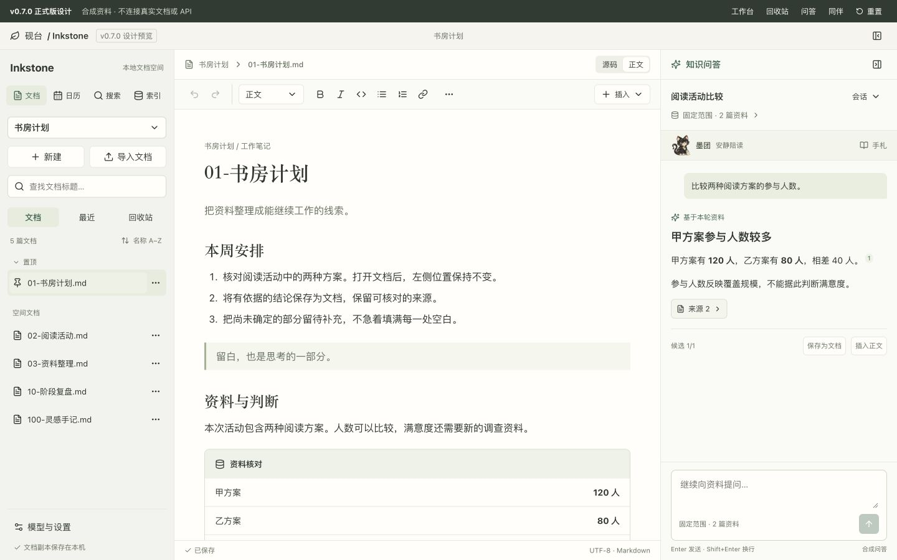

左侧“文档 / 最近 / 回收站”固定，排序入口显示当前模式。置顶独立分组；打开正文只改变选中项，默认名称顺序不变。

## 2 独立最近视图

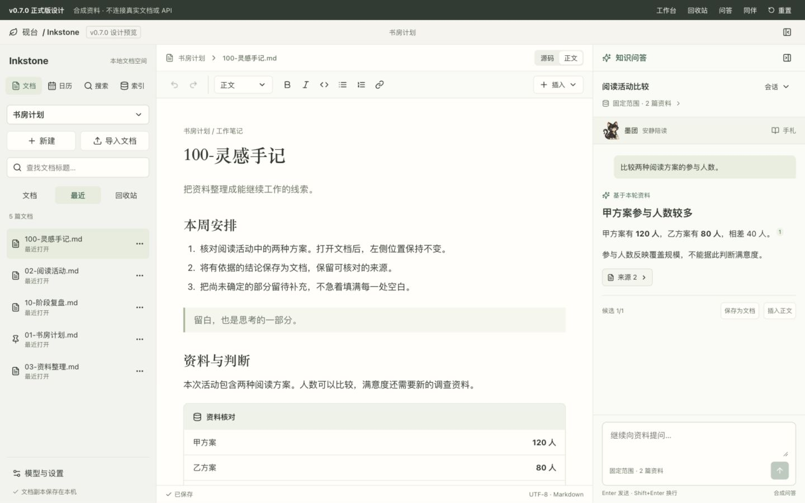

刚打开的 100 文档出现在最近顶部，不影响空间文档默认顺序。最近是访问历史，不是组织文档的唯一方式。

## 3 回收站摘要与永久删除

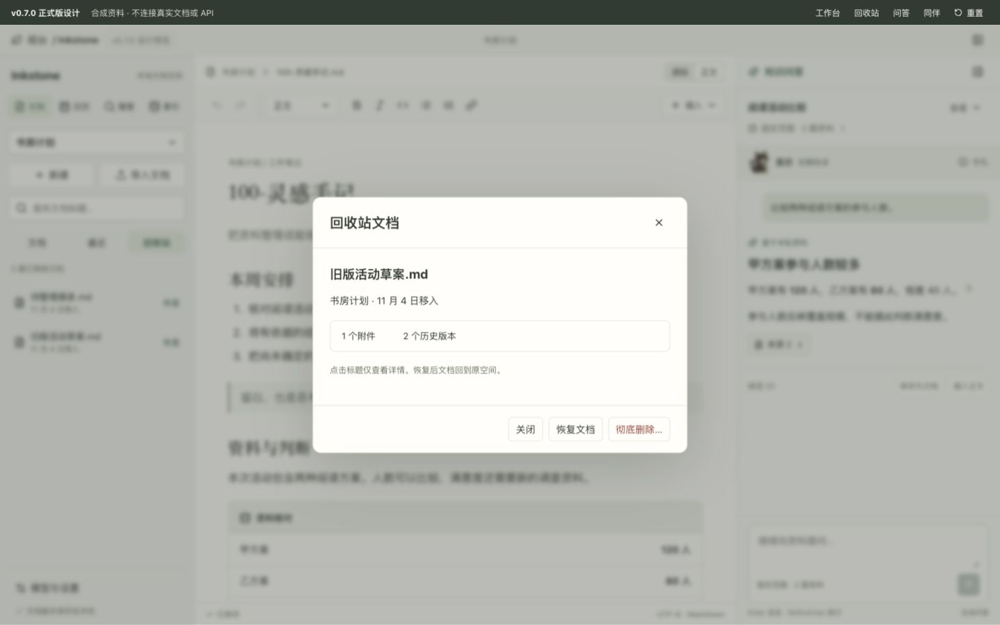

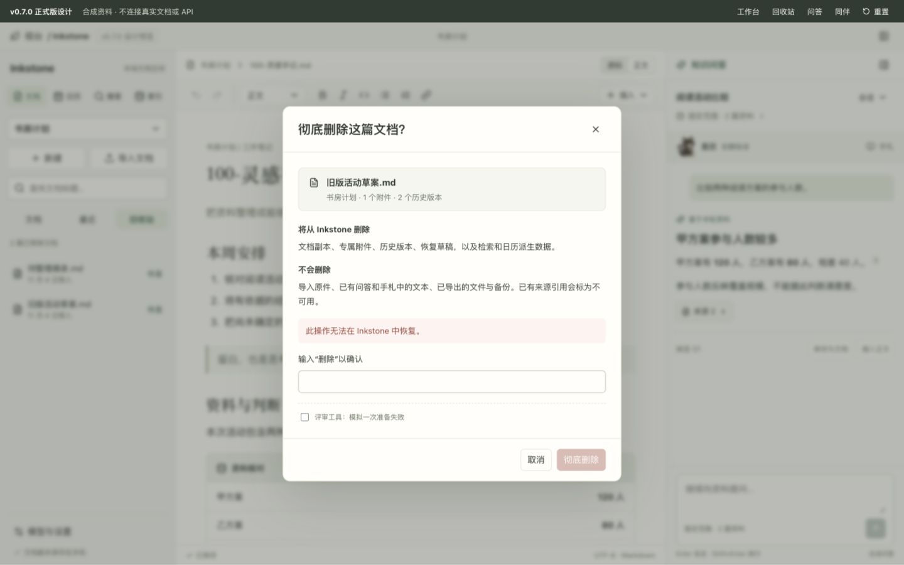

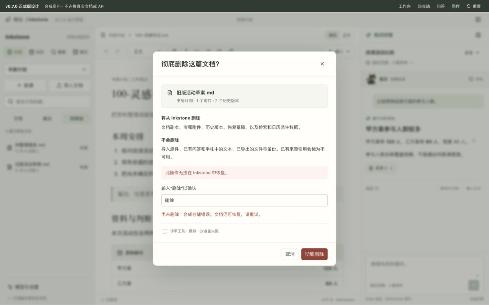

标题点击不恢复；危险操作说明范围，并需输入确认。图中故障模拟属于评审工具。已进入不可逆阶段后的“清理未完成”是后端实现要求，本原型不模拟跨库恢复。

## 4 问答与来源

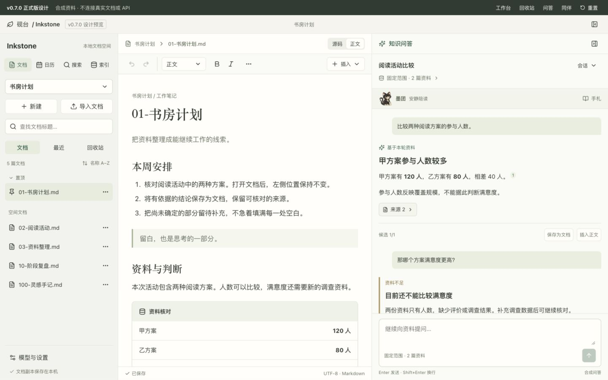

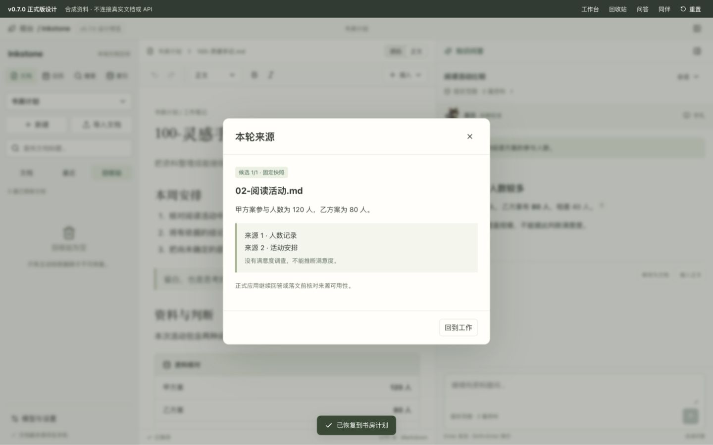

每轮结果、来源、候选和落文操作放在一起；缺少满意度资料时明确拒绝比较，不把人数推成满意度。

## 5 安静同伴

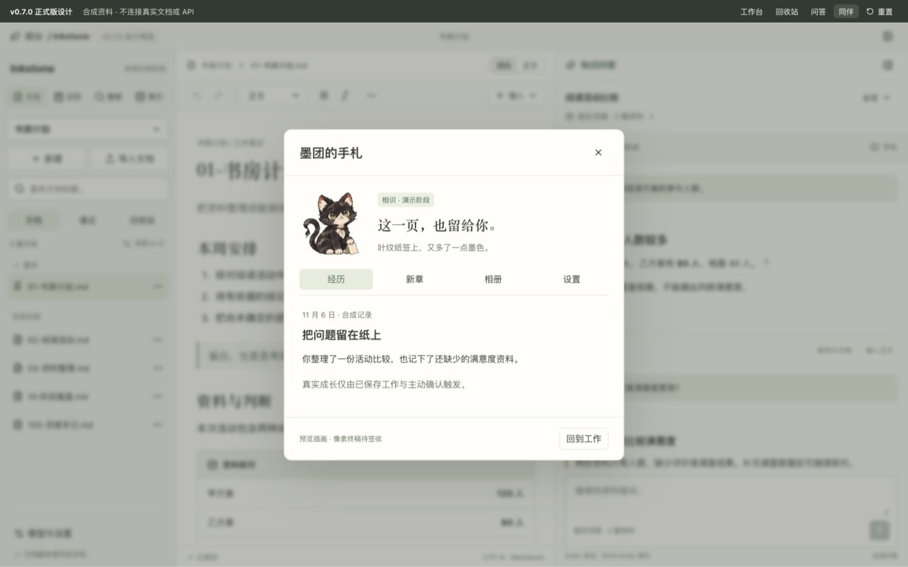

同伴工作时占一行，手札由用户主动打开。图像为概念预览，最终阶段立绘与 CG 仍须单独签收。

## 6 窗口适配

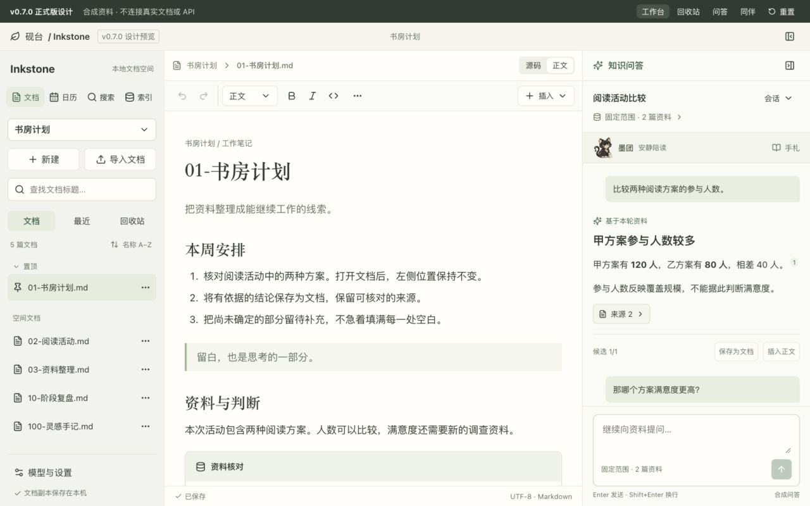

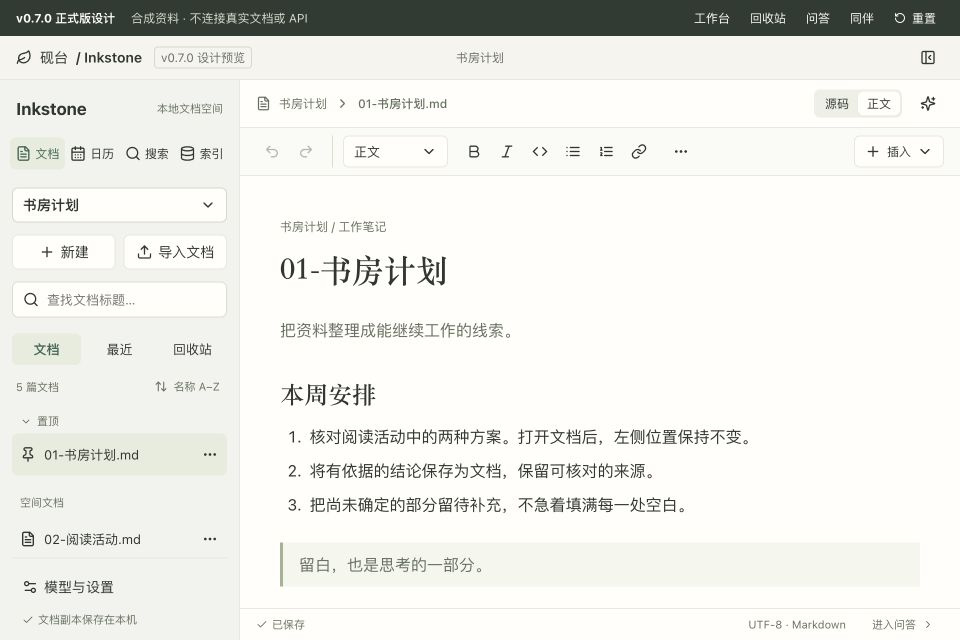

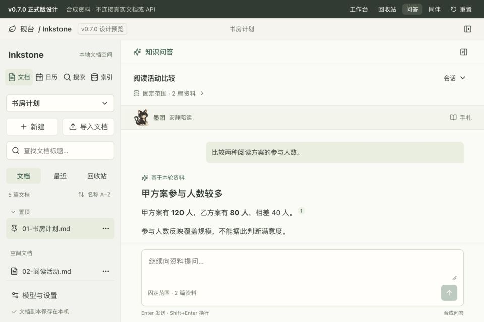

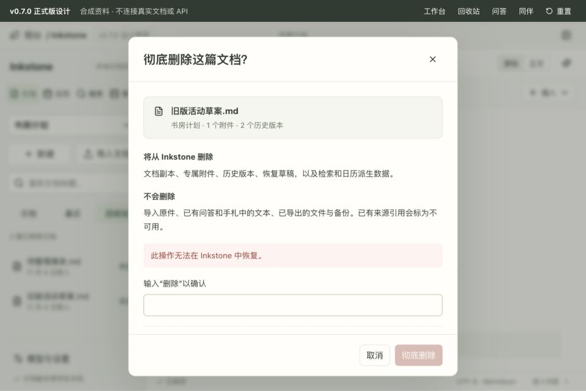

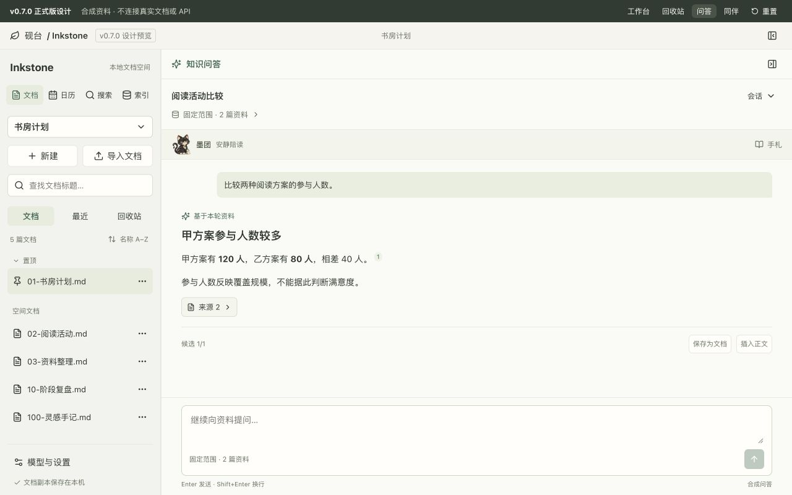

窄窗保留资料导航，编辑和问答轮换；确认弹窗内容可纵向滚动，底部取消与危险操作固定可达。小窗口不强行挤出三个细栏。
