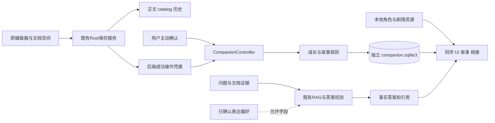
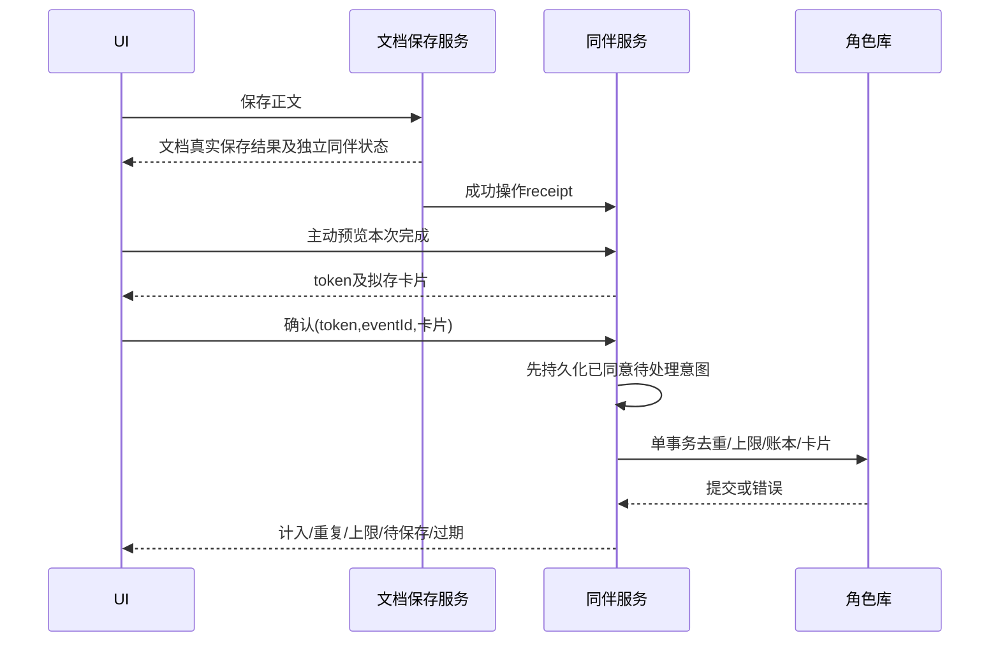

# Inkstone v0.7 技术架构与业务契约

2026-11-04修订，生产实现设计。现有React 19、TypeScript、Tauri 2、Rust、rusqlite、Markdown与检索管线继续复用；不新增应用服务器、向量数据库服务、角色大模型或游戏引擎。新增能力收敛在companion域，生产版本和catalog/index schema在本次设计交付中不变。

## 1 架构边界

角色服务读不到API密钥，不直接调用provider，不把卡片/故事/CG装进检索上下文。原始答案先经现有Markdown、图表及来源校验，角色短台词单独渲染。角色错误不能吞掉原始答案或将“资料不足”变成确认事实。

角色履历归本机用户档案，跨受管理空间共享成长；账本保留spaceId用于作用域审查，卡片可按空间筛选。工作对象身份使用catalog中的稳定ID，不从路径、标题或前端自报标识建立身份。外部目录暂不计成长。

## 2 模块拆分

| 模块草案 | 责任 | 禁止承担 |
| --- | --- | --- |
| src/companion/types.ts、ipc.ts | 类型化命令、DTO和错误映射 | 任意SQL、任意文件路径 |
| src/companion/store.ts | 快照revision、请求取消、空间/角色代际、订阅 | 用localStorage作为成长真源 |
| CompanionDock、CharacterPicker | 小幅陪伴与选择 | 接管正文或重写事实答案 |
| ExperienceDialog、Journal | 预览/确认、卡片与待处理 | 自行认定保存或发成长 |
| StoryReader、Album | 声明式故事、锚点、选择、形象 | eval脚本、HTML注入、远程资源加载 |
| src-tauri/src/companion/ | repository、rules、stories、assets、preferences、backup | 巨型lib.rs内混合业务 |
| companion_commands.rs | 会话/权限/参数校验、薄IPC适配 | SQL和规则重复实现 |
| work_receipts.rs | 接收真正成功的文档操作、建立短期凭据 | 相信前端saved=true |

App只挂载一个同伴边界并传递workspace/session信号。复用现有ModalDialog、焦点返回、类型化IPC及隔离测试feature。纯搬文件和业务改动分开提交；无需为了角色重写编辑器、内容AST或检索编排。

## 3 数据模型

独立库`companion.sqlite3`，schema1，位于现有应用私有数据目录的专用子目录。数据库不是加密承诺。设置、剧情和成长由Rust单写服务管理，开启foreign_keys，写入使用事务及有限busy_timeout，数据库忙错误返回可重试状态。

| 表 | 核心字段与约束 |
| --- | --- |
| meta | profile_id、schema_version、generation、revision、timezone、timezone_effective_at |
| settings | enabled、character_id、mode、reduced_motion；枚举校验 |
| work_receipts | receipt_id、origin_operation_id、doc_id、space_id、source_hash、occurred_at、day_key、generation；不存正文 |
| experience_ledger | event_id PK、receipt_id UNIQUE、doc_id、space_id、day_key、kind、participating_character、generation；UNIQUE(generation,doc_id,day_key) |
| experience_cards | event_id FK、user_confirmed_text、source_label(可空)、created_at、updated_at；可硬删除正文 |
| role_progress | character_id PK、outfit_asset_id、read_anchor；穿戴须已解锁 |
| story_state | character_id、node_id、content_version、status(read/skipped)、choice_id可空；复合主键 |
| unlocks | character_id、stable_asset_id、unlocked_at、source_node_id；复合唯一 |
| preferences | id、allowed_key、value、scope、scope_id、enabled、revision、confirmed_at；范围与字段白名单 |

日上限不是“先查再写”的前端逻辑。确认事务使用`BEGIN IMMEDIATE`串行核对generation、凭据、同对象同日及全局当日数量，插账本/卡片、增加revision再提交。重试同event返回原结果，重复receipt不发奖励。统计从账本派生；不维护一套容易失配的可写XP余额。

卡片删除不删除账本的最小去重标识；来源标签和私有文本不残留在账本。数据库不记录私人正文、原始问答或全路径。彻底清空推进generation，建立空库/空状态，旧event/token不能再使用。

## 4 工作成功凭据与双事务

前端按钮、字数和“保存成功”提示都不足以授予经历。真实Rust保存服务在现有写入成功之后，生成operationId、受管理docId、spaceId、contentHash和后端时间的receipt。companion开启时由适配层登记；登记失败只返回独立companionWarning，不能改写文档SaveResult。

凭据仅记录已发生操作，不等于用户同意保存经历文本。预览命令核对当前对象仍存在、未在回收站、hash一致、会话及generation有效，发15分钟有效的后端不可伪造previewToken。客户端不能通过传入另一个标题/路径获得凭据。无有效凭据时明确要求先保存实际工作，不后台扫描旧历史。

待处理意图用原子临时文件替换，内容是用户已同意的卡片、receipt和稳定eventId，目录私有。事务成功后删除；若提交后删除前崩溃，重开显示待处理，手动重试通过唯一键返回原结果。待处理意图也属于导出/清空/备份范围，不能成为删除后复活的旁路。

意图写入本身失败（磁盘满等）时，不宣称已持久保留，提示“文档已保存，本次经历未保存；关闭后需重新确认”。仅内存重试不承诺崩溃恢复。事务失败可手动重试，不重新保存正文。凭据过期、内容变化或会话失效需重新预览；历史已用originOperationId在同一generation永不再次计入，过午夜重试也不改发生日。

初版仅对本会话收到的成功操作提供预览；若登记失败后进程退出，没有可靠receipt则要求新的显式工作保存/确认，不伪造旧操作。日上限限制成长，不是工作能力限制。

## 5 命令与错误契约

共同上下文为`requestId, sessionGeneration, companionGeneration, spaceId, expectedRevision`。Rust从当前Workspace与档案核验，不能仅回显客户端值。只读分页有长度上限；写入字符串长度、枚举、对象范围均后端校验。

| 命令 | 主要输入 | 输出 |
| --- | --- | --- |
| companion_get_state | 上下文 | 快照、revision、成长统计、pendingChapter、错误诊断 |
| companion_set_settings | expectedRevision、enabled、characterId、mode、reducedMotion | 新快照；非法/未解锁形象拒绝 |
| companion_preview_experience | receiptId | token、规范事件ID、预览文本、dayKey、expiresAt、可计入原因 |
| companion_confirm_experience | token、eventId、confirmedText、consent=true | counted / duplicate / daily_limit / expired / stale / pending |
| companion_list_cards | spaceFilter、cursor、limit≤50 | 当前范围卡片和下一页 |
| companion_get_story | characterId、nodeId、version | 纯文本节点、合法选项、资源ID |
| companion_complete_story | nodeId、read/skipped、choiceId可空 | 前序/门槛校验后的新解锁；重复幂等 |
| companion_mutate_preference | 白名单字段、范围、expectedRevision | 新revision；不接收自由系统提示 |
| companion_delete_card / preference | id、expectedRevision | 删除及缓存失效结果 |
| companion_export / reset | 明确范围、短期确认token | 安全导出/清空；不触及工作文档与Keychain |

错误码：WORK_NOT_SAVED、SOURCE_CHANGED、SOURCE_UNAVAILABLE、TOKEN_EXPIRED、STALE_CONTEXT、REVISION_CONFLICT、DAILY_LIMIT、DISABLED、STORAGE_ERROR、ASSET_MISSING。UI区分业务上限、无效操作和可重试IO，不全部显示“网络错误”。

请求带当前空间、角色及代际；UI收到晚响应先丢弃。后端在写事务内再次校验generation与enabled。关闭和reset与confirm共用写入串行边界：关闭先提交则拒绝后续确认，确认先提交则这是关闭前的有效经历，不撤销或谎报关闭后的新增长。

## 6 剧情、资源与偏好

剧情是带schemaVersion的JSON声明节点：stableId、characterId、stage、text、choices、mergeNode、unlockAssetIds。不允许JS、任意HTML或从远程URL执行内容。每角色每阶段节点链可静态校验无死路；所有分支回到声明的merge节点。

资源manifest记录id、contentVersion、sha256、file、mime、width/height、pixelBaseSize、safeArea、alt、source、licenseStatus。资源路径仅从打包清单解析，拒绝绝对路径和路径穿越；hash不匹配用文本状态替代，不清除已解锁身份。

本地台词由实际结果事件映射，条目有characterId、stage、mode、eventType、variant；随机或轮换不会改变事实。偏好仅在既有回答格式装配点注入允许字段；不携带经历文本，不为角色单独加一次模型调用。

人格、角色故事和用户偏好是三个概念。故事不写入事实Prompt；昵称仅作用于称呼；模型API更换不改剧情选择。RAG继续使用v0.6.6范围/hash、BM25/向量/RRF、可选重排、evidence和答案校验；新角色不放宽任何证据门槛。

## 7 备份、迁移与清空

现有备份实现已使用`VACUUM INTO`导出catalog快照，角色库复用同类快照方法或SQLite Backup API，不直接复制活跃WAL库。后者提供一致快照，见[SQLite官方备份文档](https://sqlite.org/backup.html)。

备份manifest拟从当前格式升级到兼容读取的新版本，新增可选companion段：schema、generation、resourceVersion、快照hash、卡片/偏好/剧情数量和待处理意图清单。旧包明确显示“不包含角色数据”。旧应用不得静默恢复新格式；索引继续可重建，Keychain不打包。

多库不是单个SQLite事务。备份协调器冻结新写入，排空文档保存及角色确认，记录快照epoch，分别导出库及待处理，再校验正文/catalog/角色快照期间未变化；成功后恢复写入。超时或变化中止备份，不能生成貌似成功的混合时点包。

恢复先在新目录解压，检查路径/体积/hash/schema、foreign_key_check、quick_check、资源ID和计数，展示预演，再按现有新目录恢复流程切换。不合并旧角色库；选择不恢复角色时建立新generation空库，防止沿用旧待处理事件。

删除卡片或偏好清除活跃正文和提示缓存，SQLite旧页/用户持有的历史备份可能含旧数据，不承诺取证级擦除。彻底清空先阻断写入、推进代际并清除待处理/缓存；再以空库切换，失败保持明确可恢复状态，不在部分删除时显示成功。

## 8 权限与无障碍

仅主本地WebView可调用同伴命令，资源展示frame不能调用。Tauri应用自定义命令需要显式纳入权限清单并收窄，不能仅因配置了某个capability就声称所有自定义命令已隔离；按[官方能力说明](https://v2.tauri.app/security/capabilities/)核对真实manifest与调用测试。前端无通用数据库/文件写接口。

无新增登录、系统密码配置或Keychain权限。默认本地素材、无CDN、无额外模型请求。原型独立浏览器localStorage与生产数据完全分离。

默认减少动态并尊重系统偏好；可暂停、隐藏，动画不抢IME焦点，不用颜色单独传递锁定/失败。自动运动内容要可暂停，原则见[W3C暂停停止隐藏](https://www.w3.org/WAI/WCAG22/Understanding/pause-stop-hide/)。这只是设计依据，不能替代原生VoiceOver和输入法验收。

## 9 测试与性能目标

| 层 | 必测内容 |
| --- | --- |
| Rust规则/事务 | 双条件、前章、同对象同日/跨角色去重、并发上限、午夜/时区、hash变化、损坏资源 |
| 故障注入 | 磁盘满、busy、提交前后崩溃、意图删除失败、关闭/reset与晚到confirm竞争 |
| 数据控制 | 卡片删除仍去重、清空后旧响应/意图不复活、新旧备份、只恢复文档 |
| 前端 | focus/gentle、关闭/隐藏、键盘返回、未保存输入、窄窗、长中文、状态不只靠颜色 |
| 内容 | 九章、稳定ID、所有选择汇合、资源缺失/旧版本迁移、昵称不来自文档 |
| 知识回归 | 资料不足、旧来源、跨空间、Markdown/图表、每轮新增角色请求0 |
| 原生 | WebKit保存/重开、真实拼音候选、VoiceOver、减少动态、冷启动 |

拟定性能预算而非现状结果：已载入同伴面板本地交互P95≤100ms；确认事务在千条账本下P95≤100ms（不含磁盘异常）；关闭时无动画定时器/后台模型调用；角色资源延迟加载，基础工作台首次启动耗时相对基线增加≤10%。固定同一机型、冷/热缓存、样本数≥30再判断，超标先测量定位，不以调高阈值结案。

本次离线原型检查不等于上述生产测试通过。实施顺序与停止点见[开发计划](PLAN.md)。

## 10 问答会话域的增量架构

多轮会话属于assistant域，独立于companion库。复用现有RAG/Answer渲染，新增会话、轮次、候选与来源快照持久化，以及按request/conversation/generation/sequence归属的真实流事件。角色reset不清会话；备份协调器须同时排空assistant、companion与文档写入。完整模型、命令和流状态契约见[知识问答工作台](QA-WORKBENCH.md)。系统级桌宠浮层留待后续评估，应用内小同伴不增加多窗口权限。
