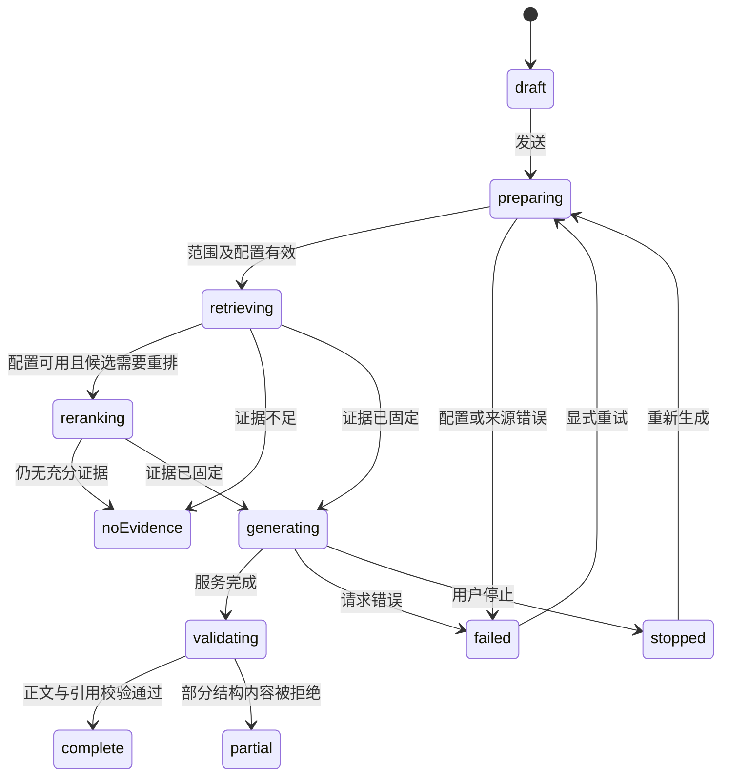

# Inkstone v0.7 知识问答工作台设计

2026-11-04。本轮将问答体验作为v0.7的核心工作流改进，与同伴系统分别开发和验收。目标是让用户能持续追问、核对依据、管理范围，并把结论落到自己的文档里。

## 1 现状与参考

v0.6.6已有问答生成阶段、取消、来源快照、Markdown/图表及回答落地能力。当前前端以单轮`asked/answer`状态及`ask_question`为主，下一轮替换当前展示，尚未形成有历史、分支与稳定来源归属的会话模型。主要差距是组织与连续性，不能把它描述成“没有生成状态或引用”。

参考[AnythingLLM的问答模式](https://docs.anythingllm.com/features/chat-modes)对资料问答与开放聊天的区分，以及[Dify官方检索节点说明](https://github.com/langgenius/dify-docs/blob/main/en/cloud/use-dify/nodes/knowledge-retrieval.mdx)中片段内容、文档元数据和引用传递的结构。本项目选择资料问答默认路径，不因为要更会聊天就悄悄引入无来源常识；以下页面和流程是Inkstone的设计决策，不是竞品功能完整审计。

## 2 三个入口和一个会话模型

1. 编辑伴随问答：保留右侧栏，用于当前段落/文档附近的问题和插入答案。
2. 展开问答：独立大阅读区，保留左侧空间上下文，答案宽约760–820px，适合长回答、表格、图表与多轮核对。
3. 从文档/选区发问：将对象作为显式范围或引用附件，输入框里可见，不暗中传整份资料。

三者操作同一会话，不各自复制一套历史。角色是可收起的辅助状态区，不取代“知识回答”身份。问答页的核心区域让给轮次、答案和来源；长答案不挤在宠物卡片下面。

会话归属一个稳定spaceId。创建时冻结资料范围（空间/当前文档/选定文档集），每一轮另记录实际索引/来源版本、模型与检索方式。切换空间不复用旧会话；改变范围先说明并新建会话，原会话保留。原型已演示空间/当前文档两种范围；文档集选择进入正式实现。

## 3 发送前

空态提供真实任务模板：比较文档、总结指定资料、列出待补信息，点击只填入问题，不直接发送。输入框支持多行、待发送草稿、范围标签与引用附件。Enter发送/Shift+Enter换行保护中文合成；模型未配时保留问题并导向设置，返回不丢草稿。

范围栏常驻显示“当前空间/当前文档/选定N篇”；索引未就绪、部分失败或来源更新时，先显示可操作状态。用户能选择先用现有资料、更新索引或取消；不静默将范围扩大到整个电脑。

## 4 生成中的状态机

显示可理解的短状态：“正在准备资料”“找到6条候选，核对依据中”“正在生成”“核对图表和引用”。不暴露或编造模型思维链。阶段与实际事件绑定；不把等待网络包装成持续检索动画。

服务支持SSE时显示真实增量文本。中止立即停后续消费与UI更新，并请求后端取消；已发出的远程请求可能仍产生费用，不声称按下停止就能撤销账单。供应商不支持stream时使用完整响应与诚实等待状态，不做假打字来掩盖延迟。

流式期间仅渲染安全文本/已闭合的基础Markdown。Mermaid、JSON表单、脑图和chart块待围栏闭合及结构校验后再渲染；最终数字/来源校验前不提供“可直接引用”的图表。未通过图表保留原因与安全文字，不导致整条事实答案消失。

## 5 每一轮回答

回答有三个层次：结论与正文、关键引用/来源列表、默认折叠的检索诊断。普通用户不需要先理解向量模型、RRF或阈值；故障与高级设置仍可查看候选、证据资格、重排降级、模型和耗时。

点击S1在来源抽屉/面板预览原片段，显示文档名、位置、该轮hash与当前是否变化，支持打开原文、定位和返回会话。引用ID按message/candidate归属，跨轮S1不能错误指向上一轮文档。历史快照与当前原文不同要明确标注，重新生成时重新检索，不把旧证据当当前事实。

操作：复制Markdown、保存新文档、插入当前文档、重新生成、反馈问题。插入前显示目标、位置与变更预览，expectedHash校验避免覆盖新输入；保存保留引用来源清单和生成时间。下载只是导出，不冒充已保存到空间；原型同时提供两者。

反馈先本地保存“缺依据/事实错误/答非所问/格式问题”，可附用户备注。不默认上传正文、对话或证据；用户选择导出合成复现或明确提交。反馈不自动修改检索阈值。

## 6 多轮、修改和重试

追问保留用户已看到的历史。指代解析仅使用同一会话允许的用户问题/显式对象；历史AI回答不是新的文档证据。像“它们哪个更好”若缺明确维度，先澄清，不按宠物语气猜一个答案。每一轮仍按当前范围检索并核对证据。

首版上下文预算建议最近6轮/最多4000个历史token，以先达到者为限；实际模型上下文不够则进一步收紧并提示。用户问题和已确认对象优先，旧答案可作会话语境但标为未验证内容，不加入evidence计分。无跨会话自动记忆。需要额外模型改写时必须单列开关/成本，默认不为追问额外增加一个规划调用。

修改过去问题建立分支，不覆盖旧轮次。默认展示当前分支，在分支起点可切回；重新生成建立同一问题的新candidate，保留旧candidate的正文和各自来源。重试由用户发起，限制连续重试，不能因为网络波动自动无限扣费。

原型为了可走查，修改问题作为新一轮追加，重新生成只展示候选计数；正式分支与候选持久化是开发任务，不将此简化当作已交付能力。

## 7 会话管理和数据

会话列表包含标题、空间、最后活动、资料范围与轮数；支持新建、重命名、搜索、归档、删除和Markdown/JSON导出。标题首版截取首问，不为自动取标题另发模型调用。聊天记录可能敏感，删除与导出必须明确范围，遵循现有本地资料边界。

采用独立`assistant.sqlite3`，由工作域的专用服务管理，不能放入`companion.sqlite3`。关闭/重置同伴不删除知识对话，删除会话不倒扣成长。

| 实体 | 最小字段 |
| --- | --- |
| conversations | id、space_id、title、scope_json、created/updated、archived、revision |
| turns | id、conversation_id、parent_turn_id、question、context_version、created_at |
| candidates | id、turn_id、status、text、model、finish_reason、request_id、snapshot_id、created_at |
| evidence_snapshots | snapshot_id、candidate_id、source身份/hash/片段/位置、检索状态；有长度/数量上限 |
| drafts | conversation_id、输入内容与显式附件、updated_at |

角色reset只影响同伴域；会话删除必须清除活跃内容、引用快照、草稿和导出缓存。用户自己的旧备份仍可能包含历史，恢复预演需提示。正式备份manifest同时纳入assistant与companion的schema和快照，现有跨库排空协调不能漏掉生成中的会话写入。

## 8 技术接入

先把App中的问答状态编排拆到`src/assistant/`，增量接入conversationStore、ChatTimeline、Composer、EvidenceDrawer、AnswerActions；现有Answer/共享Markdown渲染保留。Rust增加assistant service/commands及流事件适配，复用现有providers、retrieval、evidence、answer_validation，不复制RAG算法。

新增命令草案：conversation_list/create/rename/archive/delete/export；chat_start(conversationId,parentTurnId,question,expectedRevision,requestId)；chat_cancel(requestId)；candidate_select；evidence_open。后端冻结范围快照并生成来源ID，前端不能传任意证据绕过门控。

流事件包含requestId、conversationId、candidateId、workspaceGeneration、sequence、eventType及payload。先注册监听再start，按序号合并；换会话保留原请求所属身份，旧空间/已删除会话的晚响应不落库。落库与网络任务取消使用代际/删除标记保护，不能仅依赖前端丢消息。

前端每16–33ms批量刷新增量，避免每token重建图表/整条DOM；上翻时不强制滚动，提供未读计数和回到底部。断线保留未完成状态，重新生成新candidate而非拼接两次请求的未知尾巴。

## 9 验收与优先级

P0：会话范围、稳定轮次、历史、来源抽屉、可中止生成、保存/插入、跨空间与晚响应保护。P1：分支/候选切换、文档集选择、会话搜索/归档/删除导出。P2：非打扰建议追问、检索诊断优化与真实反馈闭环。角色外观不阻塞P0。

必须覆盖：三轮带指代追问、追问证据不足、换范围、换空间、原文已更新、两次生成候选、停止/超时/断线、未保存正文插入冲突、会话删除后晚响应、重启恢复、中文合成、键盘和读屏。性能分开测本地会话切换、检索、首token、总生成和图表校验，外部API延迟不伪装成本地性能指标。
