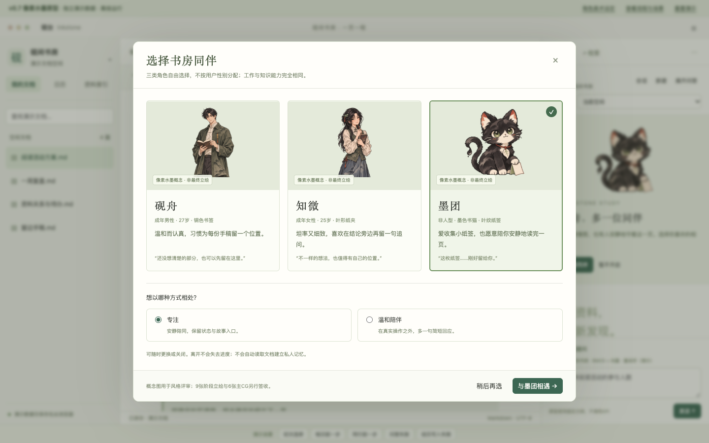
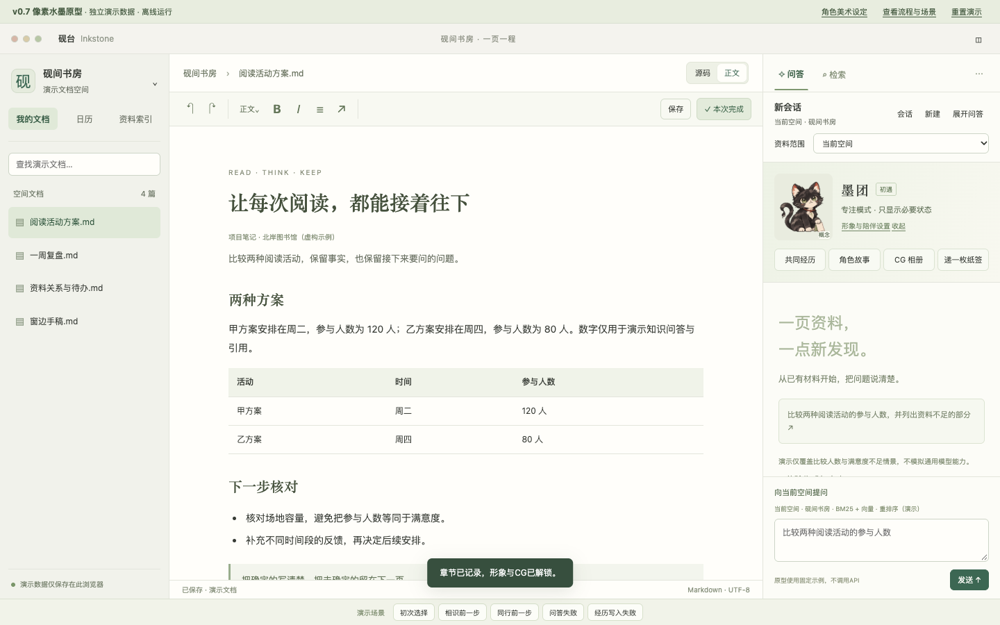
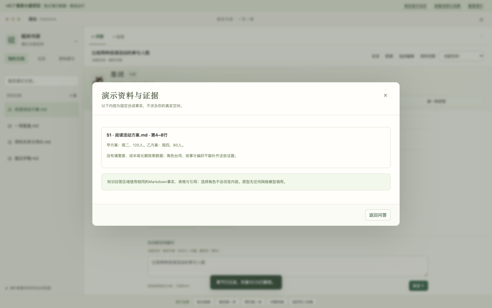
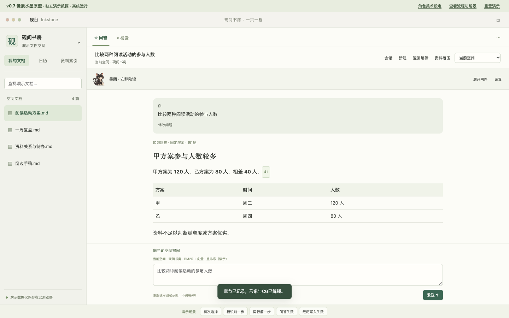
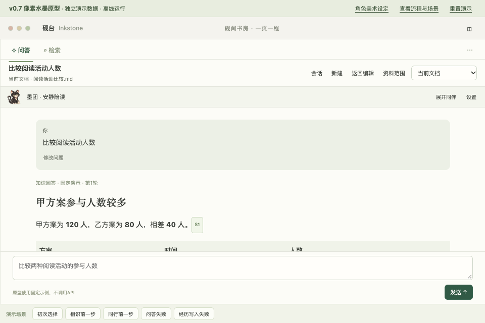

# Inkstone v0.7 设计原型检查记录

2026-11-04，范围为设计文档与独立合成原型。应用生产版本仍为v0.6.6；没有发布v0.7生产包、运行付费模型评测或上传本轮设计分支。

## 已完成

- 原型状态检查44项通过，包括既有三角色成长、分支、偏好与失败重试，以及新增真实概念资源入口、多轮追问、范围变更、新会话、中止、回答保存和角色清空不删会话。
- 经用户允许，使用独立临时配置的本地无头Chrome验收；未读取个人浏览器登录态或生产资料。
- 浏览器走通三角色选择与墨团初遇、来源预览、两轮比较/满意度不足、中止演示生成、回答保存到合成空间、范围变更新会话、历史列表及美术设定。
- 1440×900、1280×800、960×640无横向溢出，发送按钮在可视区域内；复查截图后压缩低高度输入区，保留更多答案阅读空间。浏览器pageerror为0。
- 四张概念图真实载入，文件尺寸/hash/透明信息记录于资源manifest。所有阶段成品仍为planned，不把图像复用当阶段制作完成。

原始记录：[44项状态检查](../../../prototypes/v0.7/validation.json)、[浏览器记录](screenshots/browser-validation.json)。首次JSDOM检查因反复解析完整内嵌图像导致测试进程内存不足，后将行为环境的图片载荷精简，完整图像与可见渲染另外由浏览器验收；没有通过提高内存限制掩盖该问题。

## 截图

## 实现边界

原型固定回答仅覆盖比较人数与满意度不足，其他问题显示情景边界。本地计时用于演示生成中止，未调用真实SSE；重新生成只显示候选计数，修改问题追加新轮次。正式分支树、候选全文、来源版本和数据库故障保护依照详细技术规格实施。

未运行本轮生产Rust角色/会话实现验收、原生WebKit、真实中文候选提交、实际VoiceOver、跨机或长期性能；这些不能由Chrome截图和状态检查替代。无正式逐帧sprite动画，9阶段立绘/6主CG仍待制作及许可签收。

内置浏览器控制工具两次连接失败，Codex预览打开请求返回queued，因此不据此声称已在用户可见面板打开。可通过本机HTTP或离线index.html自行打开。应用内项目文档导入仍按用户先前决定暂缓；仓库资料副本与产品内导入分别记录。
