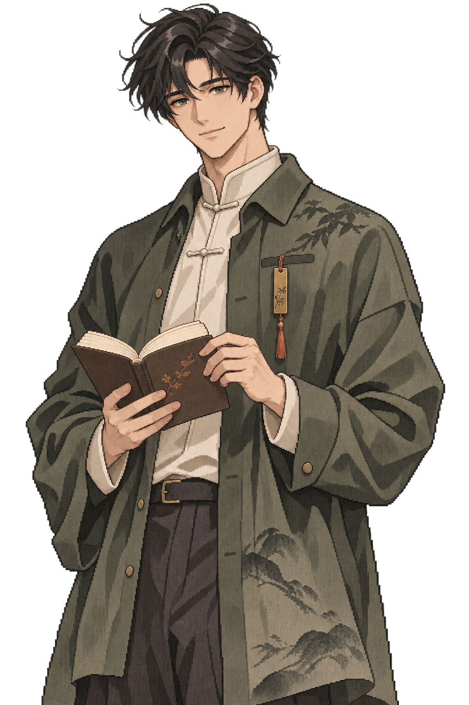
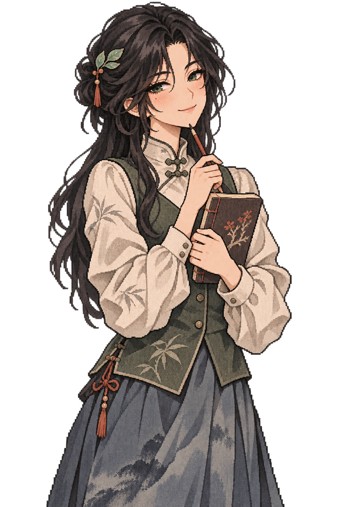

# Inkstone v0.7 像素水墨视觉设计

2026-11-04修订。视觉目标是“像素轮廓里的墨色书房”：低饱和、能长时间陪读，同时具备二次元角色的辨识、表情反差和收藏吸引力。工具界面沿用Inkstone，角色和CG承担风格表达。

## 1 像素与水墨怎么融合

像素负责轮廓、簇状明暗与动作关键帧；水墨负责内部干笔、浓淡、纸纹、竹影与留白。避免把一张普通插画简单盖上像素滤镜，也不把整个工具界面做成游戏像素菜单。正文、表单、数据图表和错误信息保持清晰的系统字体。

| 层 | 规则 |
| --- | --- |
| 角色轮廓 | 可辨的阶梯边缘、大色块；小尺寸先看清耳朵、眼睛、爪尖/标志物 |
| 角色内部 | 有限墨阶、少量纸纹；不以高频噪点覆盖表情 |
| 人型 | 明确成年比例，视觉小说式眼神与服装；像素颗粒略细，墨染呼应宠物 |
| CG | 书房留白、暖灯、纸签和共读位置；像素主体与墨色空间融合 |
| UI | 纸白底、墨绿操作、柔和分隔线；不铺满纸纹，不牺牲可读性 |

主色：纸白`#FFFEFA`、背景`#FAF9F6`、墨色`#30372F`、竹绿`#3C6753`、浅苔`#E6ECDD`。铜色`#B18D57`和朱砂`#AA6550`仅用于小物与少量强调；错误继续使用既有明确状态样式。

## 2 概念样片

四图为2026-11-03生成的本地评审概念，表达混合画风。尚未完成严格限色、逐像素整理、小尺寸重绘、同角色阶段一致性和动画帧签收，不称为已交付最终sprite或9立绘/6CG。原型在多个阶段复用这些概念，界面持续标注“非最终”。

## 3 角色风格与成长差异

| 角色 | 初遇 | 相识 | 同行 |
| --- | --- | --- | --- |
| 墨团 | 小墨影、谨慎靠近、空白纸签 | 浅叶纹、递纸签、耳朵更放松 | 书签盒、自己的座位、安稳共读；物种与脸型不变 |
| 砚舟 | 墨绿外衫、无字铜书签、认真略拘谨 | 书签有刻痕、袖口墨迹、为另一座位调灯 | 随身小册、松一点的衣领/姿态；同一张成年面孔 |
| 知微 | 青灰衣料、叶夹、折页册、微微试探 | 露出旧批注、自然笑意、纸夹换位置 | 披肩/折页册有使用痕迹，自信与害羞并存 |

“媚宅”的表现清单：墨团的大眼、小傲气和递签后故作镇静；砚舟笨拙但认真地照顾阅读位置；知微轻微调侃与坦率表达判断。奖励是更了解角色、漂亮场景、表情和物件变化，不把更暴露的服饰作为阶段价值。人物年龄在角色页可见，选择与用户性别无关。

## 4 参考虚拟宠物的呈现方式

参考用户提到的Codex虚拟宠物，采用“小型状态同伴＋可展开控制”的交互原则。当前[OpenAI官方宠物说明](https://learn.chatgpt.com/docs/pets)区分了桌面浮层、Web内嵌和CLI场景，并提供工作状态、隐藏与减少动态的说明；本项目借鉴交互原则，不复制其素材、私有实现或直接兼容其资源格式。

v0.7先做应用内小同伴：默认56–72px可视区，收起后为38px小头像和状态条。点击可看经历/故事/设置，单独有隐藏形象、暂停动作和关闭陪伴。小同伴表示idle、检索中、生成中、等待确认、完成未读或错误；状态来自真实工作事件，不凭角色表情猜测。

操作状态与成长阶段是两个维度：“正在生成”不推进相识，“新章可读”不假装AI回答完成。优先级为错误/待确认→工作中→未读成果→安静陪读；保存或IME期间不弹出故事。关闭角色仍保留工作状态文字。

系统级置顶浮层、跨应用拖动和全局快捷键先作为v0.7.1候选：它会增加多窗口生命周期、可访问性、误挡点击、窗口位置、多屏及权限验证工作。原型的应用内收起不宣称已实现系统桌宠。若试用证明浮层有价值，再用Tauri专用无敏感命令窗口实现，不复用主窗口全部权限。

## 5 动作与表达规格

墨团先做静止、眨眼、思考/寻找、完成递签、等待确认、暂停、错误停顿共7种语义状态。动作不要求一一对应独立长动画；错误与暂停优先静帧。人型先做中性、思考、完成、暂停4表情，复用身体资源。

提议宠物基础画布96×96、头像48×48、人物站姿192×288逻辑像素，整数倍导出；CG建议960×540逻辑画布再输出1920×1080。它们是待签收规格，现有高分辨率概念不等于已满足逻辑像素规范。低尺寸不清时应重绘，不能只最近邻缩放后签收。

普通眨眼6–8fps、一次1秒以内；递签一次不超过2秒，停止在静帧。默认减少动态，尊重系统偏好；后台/不可见时停动画，不持续漂浮呼吸。不做频繁闪烁、音效或自动语音。动作有语义标签和文字状态。

## 6 资源制作与签收

| 交付 | 数量 | 签收点 |
| --- | --- | --- |
| 阶段立绘 | 3角色×3阶段＝9 | 同脸/物种、同色板、服饰与标志物连续；明确阶段差异 |
| 主CG | 3角色×2＝6 | 每张对应稳定故事节点；用户视角中性，缩略图可辨 |
| 头像 | 3角色各48/72/96px | 小尺寸重绘/裁切签收，不机械缩小立绘 |
| 表情/动作 | 墨团7语义状态，人型4表情起步 | 状态真实、静帧可替代、不会盖住错误 |
| 书房/小物 | 共用场景及书签/纸夹/灯等分层 | 统一透视、墨色与灯光，前景不压过正文 |

先签收墨团一个基准像素稿和一张CG，再签两个人型基准稿，之后按阶段批量制作。每项记录作者/生成工具、来源、版本、hash、尺寸、像素基准、alt、用途及许可状态。概念评审与公开分发权利复核分别登记；当前未给未签收资产擅自追加开源许可。正式版本不依赖在线生图或热加载外部素材。
