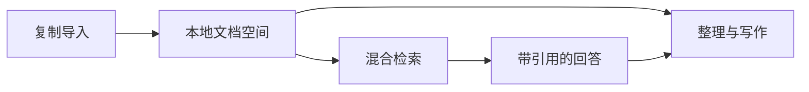

# 砚间周记

这是一份 Inkstone v0.6.6 的合成演示。机构、事项和数字均为虚构，可复制导入后自由编辑。

## 从一页笔记开始

把分散在不同位置的资料收入同一文档空间，在正文里整理想法，再从带引用的回答回到原文。

1. 复制导入资料，保留来源与更新基线。
2. 在正文与源码间切换，插入结构化内容。
3. 建立本地索引，连接自己的模型 API。

- [x] 整理本周笔记
- [x] 核对资料引用
- [ ] 下次继续写作

## 结构化记录

```json
{
  "主题": "砚间周记",
  "状态": "进行中",
  "标签": ["阅读", "写作", "资料整理"],
  "下次行动": "核对七月至九月的样例台账"
}
```

## 一条清晰的资料路径



## 用图表表达数据

下图只使用虚构台账；八月的缺测保留为空值，不补成零。

```chart
{
  "schemaVersion": 1,
  "type": "bar",
  "title": "虚构装订完成量",
  "x": {"label": "月份", "values": ["七月", "八月", "九月"]},
  "y": {"label": "装订完成量", "unit": "册"},
  "series": [
    {"name": "2026年", "values": [17, null, 26]},
    {"name": "2025年", "values": [14, 18, 22]}
  ]
}
```

## 继续整理

文档与索引保存在本机。调用模型时，所选文本、问题或证据会发送到自己配置的服务。
